# Codi — Business State Machines (canonical contract)

Status: extracted from the vanilla-JS clickable prototype (`docs/mockup/js/*.js`) and cross-checked with `docs/mockup/PRODUCT.md`. Intended for the real Next.js implementation.

**Normative rule.** Enum values, transitions, guards and side effects below are NON-NEGOTIABLE. UI copy, layout and component structure may differ. If an implementation needs a different state, get product-owner approval and change this file in a separate `docs(mockup)` PR first — never inside a feature PR.

**Conventions**
- Enum values are written exactly as they appear in code (`'pending'`, `'in_review'`, ...). Vietnamese UI labels are verbatim.
- `⚠ conflict` = the code and PRODUCT.md disagree. The code is what the prototype demonstrates; PRODUCT.md is intent. Both are noted; the implementer must resolve it with the product owner (see §24).
- Source refs are `js/file.js` + function/action name (no line numbers).
- "Action" names are the `Codi.action('...')` ids in the prototype. Actor = who triggers it.

---

## 0. Entity index

| # | Entity / process | Primary source |
|---|---|---|
| 1 | Global invariants | PRODUCT §7, §10 |
| 2 | Course ownership (derived) | `core.js` `ownership()`; `learner-commerce.js` `ctaFor`, `purchaseCard`, `purchaseCardDetail` |
| 3 | Cart | `learner-commerce.js` `addToCart`, `cartSummary`, `cm-remove`, `cm-undo`, `/cart` route |
| 4 | Voucher | `learner-commerce.js` `checkVoucher`, `cm-voucher`, `cm-voucher-remove`; `admin.js` `ad-voucher-form`, `ad-voucher-toggle` |
| 5 | Order + payment + checkout UI | `learner-commerce.js` `createOrderFromCart`, `startSim`, `markPaid`, `cm-cancel`, `cm-new-code`, `cm-i-paid`, `/checkout` route |
| 6 | Enrolment | `core.js` `enroll`, `isEnrolled`; `learner-commerce.js` `markPaid`, `cm-enroll-free` |
| 7 | Course onboarding (goal, fork, diagnostic) | `learner-learning.js` `/learn/:courseId/onboarding` route, `ln-goal-*`, `ln-fork-*`, `ln-diag-*`, `ln-take-diag` |
| 8 | Personal path | `learner-learning.js` `generatePath`, `ln-make-path`, `ln-retry-path`, `ln-edit-goal`, `ln-goal-next` |
| 9 | Lesson checklist & completion | `learner-learning.js` `checklist`, `lessonStatus`, `lockInfo`, `ln-complete`, `ln-mark-studied` |
| 10 | Quiz attempt | `learner-learning.js` `quizSection`, `ln-quiz-*` |
| 11 | Assignment submission | `learner-learning.js` `assignmentSection`, `runUpload`, `ln-assign-*`, `ln-resubmit*` |
| 12 | Coding exercise attempt | `coding-practice.js` `status`, `score`, `run`, `grade`, `cp-run`, `cp-solution`, `cp-reset` |
| 13 | AI tutor | `ai-tutor.js` `turn`, `tutor-*` actions |
| 14 | Lesson Q&A & lecturer conversation | `learner-learning.js` `ln-qa-post`; `ai-tutor.js` `tutor-lecturer-send`; `lecturer.js` `tc-reply`, `tc-conversation-*` |
| 15 | Course review (learner + lecturer reply) | `learner-learning.js` `openReview`; `lecturer.js` `tc-review-reply` |
| 16 | Course lifecycle | `lecturer.js` `tc-create`, `tc-submit`; `admin-review.js` `rv-approve`, `rv-request`, `rv-reject`; `admin.js` `ad-hide`, `ad-unhide` |
| 17 | Publication review rounds & criteria & flags | `course-review.js` (whole module); `admin-review.js` `rv-crit`, `rv-flag-*`; `lecturer.js` `tc-flag-fixed`, `tc-flag-reopen` |
| 18 | Knowledge map + concept/edge review | `lecturer.js` `kmapOf`, `runAnalysis`, `contentChanged`, `tc-kmap-*`, `findCycle` |
| 19 | AI-generated drafts (lecturer) | `lecturer-ai-create.js` `generate`, `apply`; `lecturer-ai.js` `task`, `apply`, `generateQuestions` |
| 20 | Grading | `lecturer.js` `tc-grade`, `tc-grade-ai`, `tc-grade-history` |
| 21 | User account | `admin.js` `ad-role`, `ad-deactivate`, `ad-reactivate` |
| 22 | Notifications | `core.js` `notify`; each emitting action listed in §11 |

---

## 1. Global invariants

Each invariant names what the code enforces; violations are bugs.

| ID | Invariant | Evidence |
|---|---|---|
| G1 | **Confirm vs undo (PRODUCT §7.17, decision 34).** Reversible self-actions (remove from cart, delete a draft item, remove snippet) happen immediately with an undo toast naming the item. Actions affecting another person or money (deactivate user, reject/hide course, cancel order, change price, change role, deactivate voucher) need a confirm dialog that states consequence + reversibility. | `cm-remove`/`cm-undo`; `ui.confirm` in `admin.js`, `admin-review.js`, `learner-commerce.js` `cm-cancel` |
| G2 | **Reason required for actions that affect others:** admin reject (`rv-reject`), request changes (`rv-request`), hide (`ad-hide`), deactivate (`ad-deactivate`), lecturer grade edit of a graded submission (`tc-grade`), mark flag fixed (`tc-flag-fixed`). | `requireReason` in those handlers |
| G3 | **Never auto-redirect after success.** Payment success, lesson completion, course completion and grading "next" wait for the user. Exception: navigation after the user's own explicit submit (e.g. `tc-grade` with "Bài tiếp theo"). | `/checkout/success` route; `ln-complete` (scroll only); `cm-checkout` |
| G4 | **Mastery is never colour-only.** Every mastery value renders with the 5-stop text label. | `ui.mastery()` used in `ln-*`, `diagResultView`, `/learn` |
| G5 | **AI never grades and never acts without the user.** AI suggests (grade suggestion, tutor answer, KMap items, question drafts, path reason); a human or the learner commits. | `lecturer-ai.js` `gradeSuggestion`; `tutor-diff` (apply only on click); `apply()` in `lecturer-ai*.js` |
| G6 | **Prerequisites are a hard constraint.** A lesson whose prerequisite concept is not yet covered is `locked` and cannot be opened or completed. Override only via mastery ≥ 3 on the prerequisite concept. | `learner-learning.js` `lockInfo`, `lessonStatus` |
| G7 | **Diagnostic never gates learning and never resets progress.** Taking/retaking the diagnostic keeps `completed`, `studied`, quiz records and assignment submissions. (Exception: path order can be reset; see §7 ⚠.) | `ln-fork-default`, `ln-diag-skip`, `ln-take-diag` |
| G8 | **Never block the learner on AI failure.** Path generation failure falls back to `defaultOrder`; tutor failure shows an inline error with "Hỏi giảng viên" still available. | `generatePath` (`pathAI==='fail'`); `turn` error branch |
| G9 | **AI never generates or applies a full solution.** Tutor diffs are ≤ 3 lines and only applied on click; hints are a 3-step ladder. | `ai-tutor.js` header rules; `tutor-diff`, `tutor-hint` |
| G10 | **Payment never times out silently.** Every problem state shows the `order.code` (`CODI#####`) and a support entry (`hotro@codi.vn`). | `/checkout` route, `failed`/`underpaid` branches |
| G11 | **Manual check never replaces auto-check.** "Tôi đã chuyển khoản" starts a cooldown and an informative modal; the auto-poll keeps running. | `cm-i-paid`, `startSim` |
| G12 | **Ownership-aware CTAs everywhere.** Catalog card, course detail, AI advisor card show the same CTA mapping (§2). | `ctaFor`, `purchaseCard(Detail)`, `ai-advisor.js` |
| G13 | **Lecturer/admin "counts lead to queues."** Every to-do count links to a filtered queue. | `lecturer.js` home tiles; `admin.js` dashboard |
| G14 | **Only learner role can buy/enrol.** Lecturer/admin see "Chỉ tài khoản học viên mới mua được khoá học." | `addToCart`, `cm-enroll-free`, `purchaseCard` |
| G15 | **Action gate returns intent.** A gated action (add to cart, buy now, free enrol) completes after sign-in. | `core.js` `requireAuth`, `openSignIn` |

---

## 2. Course ownership (derived state)

**Enum (derived, never stored):** `owned` | `pending-payment` | `in-cart` | `free` | `not-owned`

Source: `core.js` `ownership(courseId)`.

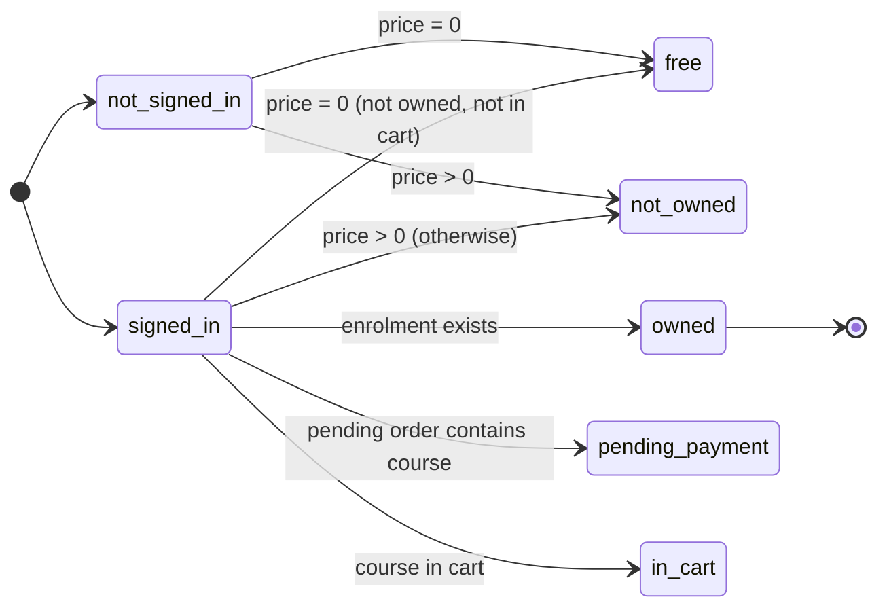

**Evaluation order (first match wins, signed-in):** `owned` → `pending-payment` → `in-cart` → `free` (price 0) → `not-owned`. Guests get only `free` / `not-owned` (no cart, no orders). A missing course returns `not-owned`.

**Transition triggers (derived):**
- `not-owned → in-cart`: `cm-add` → `addToCart` (guard: role `learner`, not owned, not pending).
- `in-cart → pending-payment`: `cm-checkout` → `createOrderFromCart` (cart is cleared, order holds the item).
- `pending-payment → owned`: order → `paid` → `markPaid` → `enroll`.
- `pending-payment → not-owned`: order cancelled/failed (course returns to cart on cancel; on `failed` it does not).
- `free → owned`: `cm-enroll-free` (guard: learner).
- `in-cart → owned`: a cart item the learner already owns is auto-removed by `/cart` route.

**CTA mapping (`ctaFor` for cards; `purchaseCard`/`purchaseCardDetail` for detail — the detail version is the one actually routed):**

| Ownership | Card CTA (`ctaFor`) | Detail purchase card | Action |
|---|---|---|---|
| owned | "Tiếp tục học" (primary) → `/learn/:id` | progress bar `done/total bài` + "Tiếp tục học" | — |
| pending-payment | "Chờ thanh toán" → `/checkout?order=` | alert "Đang chờ thanh toán" + "Tiếp tục thanh toán" | — |
| in-cart | "Đã trong giỏ hàng · Xem giỏ" → `/cart` | disabled "Đã trong giỏ hàng" + "Xem giỏ hàng / Thanh toán" | — |
| free | "Đăng ký miễn phí" | "Đăng ký miễn phí" + note | `cm-enroll-free` |
| not-owned (price>0) | "Thêm vào giỏ" | **"Mua ngay" (primary)** + "Thêm vào giỏ" (secondary) | `cm-buy-now` / `cm-add` |
| lecturer/admin role | "Xem chi tiết" | "Bạn đang xem với vai trò …" | — |

- Detail route: if course `status !== 'published'` and not enrolled → "Khoá học tạm ngừng bán" (no purchase). If `hidden` and enrolled → info notice, learning continues.
- ⚠ conflict: PRODUCT decision 42 says "Mua ngay" creates a single-course order and goes straight to checkout, leaving the cart unchanged. The code's `cm-buy-now` calls `addToCart(id)` and then navigates to `/cart` (the course is put in the cart). Decide before implementing; this file follows the code only for the cart side effect and the PRODUCT for destination is not met.

---

## 3. Cart

**Storage:** per user, `carts[userId]: courseId[]`. Lives in `Codi.state.carts`.

**States (UI-derived):** `empty` | `has-items` | `voucher-applied` | `voucher-invalid` | `pending-order-banner` (a pending order exists) | `owned-item-removed-notice` (transient).

```mermaid
stateDiagram-v2
    [*] --> empty
    empty --> has_items: cm-add / cm-buy-now (addToCart)
    has_items --> has_items: cm-add (another course)
    has_items --> empty: cm-remove (last item)
    has_items --> has_items: cm-remove (undo window, cm-undo restores)
    has_items --> order_pending: cm-checkout creates order (cart cleared)
    order_pending --> has_items: cm-cancel (course ids re-added)
    order_pending --> order_pending: cm-replace-order (old order cancelled, NOT re-added; new order from current cart)
    has_items --> has_items: /cart route removes owned items
    order_pending --> [*]: order paid (courses enrolled)
```

| From → To | Trigger (actor) | Guard / precondition | Side effects |
|---|---|---|---|
| empty → has_items | learner: `cm-add`, `cm-buy-now` | signed-in (`requireAuth`), role `learner`, not owned, not pending-payment | `setCart(cart + id)`; toast "Đã thêm … vào giỏ hàng" with "Xem giỏ hàng" |
| has_items → empty/has_items | learner: `cm-remove` | — | removes item immediately, `lastRemoved` = id (undo) |
| has_items → has_items | learner: `cm-undo` | `lastRemoved` not already in cart | re-adds item |
| any → has_items (auto) | `/cart` route on render | item `isEnrolled` | silently removed with `ownedNotice` explanation |
| has_items → order_pending | learner: `cm-checkout` | cart non-empty; if a pending order exists, modal offers "Tiếp tục đơn cũ" / "Huỷ đơn cũ, tạo đơn mới" | `createOrderFromCart`: order pushed (status pending), **cart set to []**, voucher cleared |
| order_pending → has_items | learner: `cm-cancel` (on checkout) | confirm dialog | order → `cancelled`; its course ids re-added to cart; `/cart` |
| pending → replaced | learner: `cm-replace-order` | — | old order → `cancelled` ("Huỷ để tạo đơn mới"); new order from current cart |

- Cart line item: thumbnail, title, lecturer, price, remove ×. Summary: tạm tính, giảm giá, tổng (`max(0, subtotal - discount)`).
- `/cart` shows a warn banner for any pending order ("Bạn có đơn hàng … đang chờ thanh toán").
- ⚠ conflict: PRODUCT §5 L3 says a pending order is "resumable from cart / Giao dịch". Code resumes from `/cart` banner and `/checkout` without order param (`myPendingOrders()[0]`). Consistent. But code's `cm-replace-order` cancels the old order without returning its courses to the cart (it re-enters cart only via the new order creation's cart snapshot). Implementers must keep the cart snapshot consistent — the prototype does not re-add the replaced order's courses; treat as a bug to avoid.

---

## 4. Voucher (apply / validation)

**Entity:** `vouchers[]` in db. Fields used: `code`, `type: percent|amount`, `value`, `minOrder`, `usageLimit|null`, `used`, `expiresAt|null`, `active`, `scope`.

**Validation (`checkVoucher`) — evaluated in this order; first failure wins:**

| Order | Guard | Error text (verbatim) |
|---|---|---|
| 1 | code matches (case-insensitive, trimmed) | "Mã giảm giá không tồn tại. Kiểm tra lại chính tả." |
| 2 | `active === true` | "Mã này đã ngừng áp dụng." |
| 3 | `expiresAt` null or ≥ today (end of day) | "Mã đã hết hạn từ {date}." |
| 4 | `usageLimit === null` or `used < usageLimit` | "Mã đã hết lượt sử dụng." |
| 5 | `minOrder` null or `subtotal >= minOrder` | "Đơn hàng cần tối thiểu {vnd} để dùng mã này." |

Discount: `percent` → `round(subtotal * value / 100)`; `amount` → `min(value, subtotal)`.

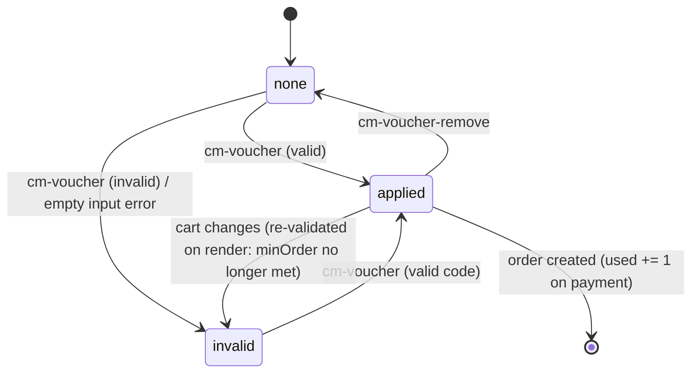

| Transition | Actor | Guard | Side effects |
|---|---|---|---|
| none → applied | learner `cm-voucher` (Áp dụng) | `checkVoucher` passes | `cart voucher[userId] = code`; toast "Đã áp dụng mã … giảm …" |
| none/applied → invalid | learner | `checkVoucher` error, or empty input | inline error by field; total unchanged |
| applied → none | learner `cm-voucher-remove` | — | voucher cleared |
| applied → invalid (implicit) | cart edit | `cartSummary` re-runs `checkVoucher` on each render | `voucherInvalid` shown; discount 0 |
| order created | `createOrderFromCart` | — | order stores `voucherCode`, `discount`, `total`; voucher cleared from cart |
| order paid | `markPaid` | — | `vouchers[code].used += 1` (only on payment, not on order creation) |

- ⚠ conflict: PRODUCT Q16 (voucher scope, per-user limit, stacking) is open. Code has `scope` in the data but no scope check; only one voucher per cart.
- Admin: `ad-voucher-form` create/edit (code 4–20 chars `A-Z0-9`, unique, immutable after create; type, value, minOrder, usageLimit, expiresAt). `ad-voucher-toggle` = active switch with immediate effect (label "Đang bật"/"Đã tắt"); PRODUCT §7.12 wants a confirm for deactivation — ⚠ code toggles immediately.

---

## 5. Order + payment (VietQR bank transfer)

### 5.1 Order status enum

`orders[].status`: `pending` | `paid` | `failed` | `cancelled` | `refunded`

Additional fields used by the prototype (not enum): `failReason: 'expired'|null`, `received: number` (partial payment), `qrFailed: boolean`, `timeline[{at,label}]`, `content` = `code`.

### 5.2 Order state machine

```mermaid
stateDiagram-v2
    [*] --> pending: createOrderFromCart / cm-new-code
    pending --> paid: webhook confirms full amount (markPaid)
    pending --> failed: 30 min elapsed without full payment (failReason expired)
    pending --> cancelled: learner cm-cancel OR cm-replace-order
    failed --> pending: cm-new-code (new order row, new code; failed row kept)
    paid --> refunded: admin (no UI in prototype)
    refunded --> [*]
    paid --> [*]
    cancelled --> [*]
    failed --> [*]
```

| From → To | Trigger (actor) | Guard / precondition | Side effects |
|---|---|---|---|
| [*] → pending | learner: `cm-checkout`; `/checkout` without order param | cart non-empty; `items` = cart courses not already enrolled; no pending duplicate unless user chose replace | order `code = CODI` + 5 digits, unique; `timeline: "Đã tạo đơn"`; cart emptied; voucher cleared |
| pending → paid | bank webhook (prototype: `startSim` after 6 s when scenario = `success`) | `received ≥ total` (prototype: outcome flag) | `paidAt`; `timeline "Đã nhận tiền"`; **enrol each item** (`Codi.enroll`); voucher `used += 1`; notify buyer (§11) |
| pending → failed | timer (`startSim`) when `now > createdAt + 30 min` | status still pending | `failReason='expired'`; timeline "Mã thanh toán hết hạn"; QR and transfer content invalid |
| pending → cancelled | learner `cm-cancel` (confirm) | status pending | `cancelOrder`; course ids re-added to cart; stop poll; navigate `/cart` |
| pending → cancelled | learner `cm-replace-order` (modal) | status pending | old order cancelled ("Huỷ để tạo đơn mới"); new order from cart |
| failed → pending (new order) | learner `cm-new-code` | previous order status failed | **new** order row (`Object.assign` copy of old, new code, `received: 0`, `failReason: null`, timeline "Đã tạo đơn (thay cho …)") — old failed row is kept |
| paid → refunded | admin | **no transition implemented** in prototype | — (filter exists in `admin.js` `ad-order-filter`) |

**Underpaid is not a status.** `received` is set (prototype: 50% of total) while `status` stays `pending`. Checkout shows alert "Đã nhận X / cần Y" with "Hãy chuyển thêm … với cùng nội dung". Expiry still applies (→ failed after 30 min). Full payment later → paid.

- ⚠ conflict: PRODUCT §2.5 says "No expiry, cancel, or failed state exists yet"; PRODUCT §5 L3 specifies expiry (30 min in prototype, Q4 open) and failed. Code implements expiry → `failed` (via `status='failed'`, not a separate `expired` status). PRODUCT §5 L3 also lists `Expired` as a checkout state — map it to `failed` + `failReason='expired'`.
- ⚠ conflict: PRODUCT Q5 (underpayment/overpayment/wrong content) is open; code has only the underpaid partial case and no overpaid handling.

### 5.3 Checkout UI states (`/checkout?order=…`)

These are the render branches of the single screen. They are derived from order status + `sim` runtime + scenario flags.

| UI state | Derivation | Primary content | Secondary / support |
|---|---|---|---|
| creating | `/checkout` with no `order` query → resume pending or create from cart | spinner "Đang tạo đơn hàng…" | — |
| awaiting | `pending`, `!qrFailed`, not underpaid | VietQR image + countdown "Hết hạn sau mm:ss" + consequence line + copy rows + 3-step tracker (step 2 active) + live status line | "Tôi đã chuyển khoản", "Hủy giao dịch" |
| qr-failed | `pending` and `qrFailed` (set by poll when scenario `qrfail`) | alert "Không tải được mã QR" + "Tải lại mã QR" (clears flag) | copy rows as text fallback; support line |
| manual-check cooldown | `sim.manualCheckCooldown > 0` (30 s) | button "Tôi đã chuyển khoản (Ns)" disabled | — |
| underpaid | `pending` with `received > 0` | warn "Đã nhận X / cần Y" + "Hãy chuyển thêm …" | support line |
| slow (no payment after 15 s, scenario `slow`) | `sim.slowShown` | support line appended | — |
| expired | `failed`, `failReason==='expired'` | danger alert "Mã thanh toán đã hết hạn" + "Tạo mã mới" (primary) + "Về giỏ hàng" | support email with `CODI#####` |
| failed (other) | `failed`, other reason | "Thanh toán không thành công" | support email |
| confirmed | `paid` | success alert "Đơn hàng đã được thanh toán" + link to `/checkout/success` | — |
| cancelled | `cancelled` | info "Đơn hàng đã huỷ" → "Về giỏ hàng" | — |
| error (order not found) | order id not found for this user | "Không tìm thấy đơn hàng" | "Về giỏ hàng" |
| error creating order / payments unavailable | **not implemented** in prototype | — | — |

Tracker steps: `Đã tạo đơn` → `Đang chờ thanh toán` → `Đã nhận tiền` (step index 1 while awaiting).

### 5.4 Polling and countdown rules

- Poll/tick: every 1 s while on `/checkout?order=<id>` for that order. Leaving the route stops the timer (order stays pending).
- Expiry: `createdAt + 30 min`. At expiry → `failed`, `failReason='expired'`, stop poll.
- Auto-check: prototype resolves the outcome after 6 s (scenario-driven). Real app: webhook/poll on the bank-transfer reference `CODI#####`; no fixed timeout before first check.
- Status line text: "Đang kiểm tra thanh toán… (lần gần nhất hh:mm:ss)".
- Copy rows: Ngân hàng, Số tài khoản, Chủ tài khoản, Số tiền (remaining amount if partial), Nội dung chuyển khoản (= `order.code`, emphasised). Each copy shows "Sao chép" → feedback.
- Transfer content must equal `order.code` exactly; a wrong content means no auto-confirmation (copy: "Sai nội dung thì hệ thống không tự xác nhận được.").

### 5.5 "Tôi đã chuyển khoản" rules

- Action `cm-i-paid`:
  - Guard: ignored while `manualCheckCooldown > 0`.
  - Effect: sets 30 s cooldown (button disabled, label countdown) and opens an info modal.
  - Modal content (prototype): auto-check continues for 30 min; accountant manual reconciliation "thường trong 2 giờ làm việc"; on confirmation course opens and learner gets a notification; order is kept; support `hotro@codi.vn`.
  - It does **not** change order status and does **not** trigger an immediate check in the prototype.
- ⚠ conflict: PRODUCT §5 L3 step 4 specifies: button → "Đang kiểm tra…" → either success, or inline "Chưa nhận được tiền — ngân hàng có thể mất 1–5 phút. Codi sẽ tự cập nhật." (tracker stays step 2; button re-enabled after a short cooldown). Code uses a modal and a 30 s cooldown. Implement PRODUCT's inline result with the code's cooldown length unless product decides otherwise.
- Poll continues regardless (G11).

### 5.6 Payment-problem support (G10)

Every state in §5.3 except awaiting-without-problem shows `order.code` and a support entry. PRODUCT: "Liên hệ hỗ trợ đối soát" (channel per Q5); code: `hotro@codi.vn`.

---

## 6. Enrolment

**Entity:** `enrolments[]` `{userId, courseId, enrolledAt}`. Unique per (user, course).

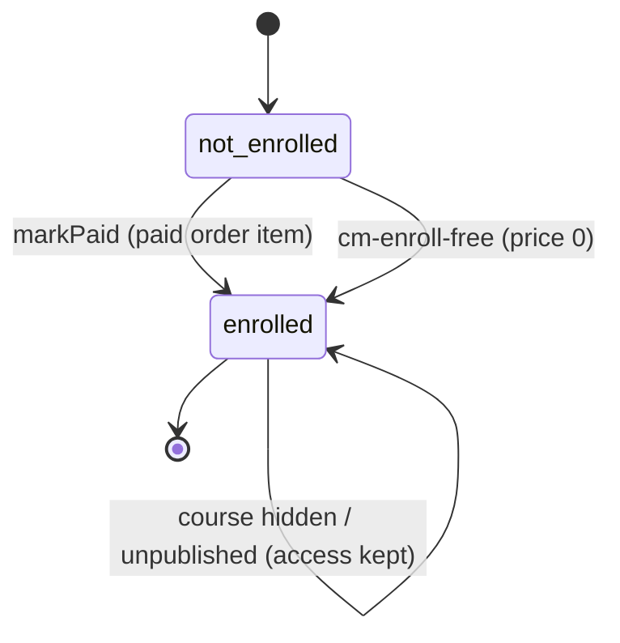

| Transition | Trigger | Guard | Side effects |
|---|---|---|---|
| not → enrolled (paid) | `markPaid` on order → paid | `isEnrolled` false (enrol is idempotent) | `enrolments.push`; `course.learnersCount += 1` |
| not → enrolled (free) | learner `cm-enroll-free` | role learner; course `price === 0` | same; then navigate to `/learn/:id/onboarding` |
| enrolled → enrolled | course `ad-hide` | — | enrolled learners keep access (course detail shows notice) |

- No removal/unenrol transition exists in prototype. Deactivating a user does not remove enrolments (see §20).
- ⚠ conflict: PRODUCT Q14 (access after hide) — code: keep access; PRODUCT Q3 (free courses without cart) — code supports direct free enrol, consistent with Q3 "API currently rejects free courses at checkout". Keep free enrolment separate from checkout.

---

## 7. Course onboarding (goal → start fork → diagnostic)

**Per-learner record:** `learnerRecord[userId][courseId]` (module slice `learning`). Relevant fields: `goal`, `goalDraft`, `goalStep`, `goalEditing`, `diag {status, index, answers, diagCardDismissed}`, `pathStatus`, `pathSource`, `order`, `skippable`, `completed`, `studied`, `quiz`, `mastery`, `lastUpdate`.

**`diag.status` enum:** `none` | `fork` | `intro` | `in-progress` | `done` | `skipped`

Goal sub-state is `goal === null` (not set) vs `goalEditing === true`.

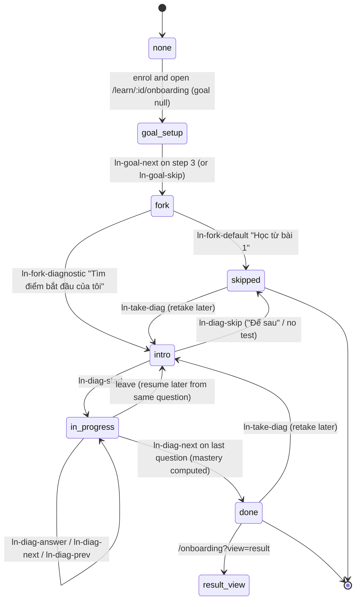

| Transition | Actor | Guard | Side effects |
|---|---|---|---|
| none → goal setup | system on first `/onboarding` | enrolled | goal view shown |
| goal step n → n+1 | learner `ln-goal-next` | step < 2 | `goalStep++`; answers kept in `goalDraft` |
| goal → fork | `ln-goal-next` (last step) | — | `goal = goalDraft`; `diag.status='fork'` |
| goal → fork (skip) | `ln-goal-skip` "Bỏ qua" | — | defaults: goal `finish`, level `new`, hours `5`; → `fork` |
| goal edit save | `ln-goal-next` when `goalEditing` | — | `generatePath(id)` (re-plans unfinished lessons; completed kept); toast "Codi đang xếp lại lộ trình" |
| fork → skipped | `ln-fork-default` | — | `diag.status='skipped'`; `pathStatus='ready'`; `pathSource='default'`; `order = defaultOrder`; `skippable=[]`; `/learn/:id` |
| fork → intro | `ln-fork-diagnostic` | — | `diag = {status:'intro', index 0, answers {}}` |
| intro → in-progress | `ln-diag-start` | course has `entryTest` | `status='in-progress'` (resume label if index > 0) |
| intro → skipped | `ln-diag-skip` ("Để sau" or "Xem lộ trình" when no entry test) | — | `pathStatus='ready'`, `pathSource='default'`, `order=defaultOrder`, `skippable=[]` (see ⚠ below) |
| answer question | `ln-diag-answer` | option or "Tôi chưa biết" (`unknown`) | records `answers[qId]`; Next enabled |
| next/prev | `ln-diag-next/prev` | Next disabled until answered | index ± 1 |
| in-progress → done | `ln-diag-next` on last question | — | mastery per concept: correct → 3, wrong → 1, unknown/unanswered → 0 (max per concept); `status='done'`; `/onboarding?view=result` |
| done → result | `/onboarding` route | `status==='done'` and pathStatus none, or `view=result` | result view: right/wrong/unknown counts, per-concept mastery bars, strengths (≥3), gaps (≤1); primary "Xem lộ trình của tôi" |
| result → path | `ln-make-path` | — | `generatePath` (see §8) |
| done/skipped → intro | `ln-take-diag` | — | resets diag answers; keeps `diagCardDismissed` |

- Diagnostic is **untimed**; intro states "Không tính điểm", question count and "Khoảng N phút" (`ceil(questions × 0.75)`). "Tôi chưa biết" is a distinct answer from wrong.
- Start fork cards: "Học từ bài 1" (note: "Học theo thứ tự mặc định…"); "Tìm điểm bắt đầu của tôi" (marked Khuyến nghị, "~10 phút"). PRODUCT says choosing "Học từ bài 1" shows an inline note of what is lost — not implemented in prototype.
- Learner home/course home show a dismissible card "Cá nhân hoá lộ trình" when `diag.status ∈ {skipped}` (`ln-dismiss-diag-card` sets `diagCardDismissed`).

**⚠ conflicts**
- PRODUCT Flow L4 says the diagnostic is "làm bất cứ lúc nào"; code allows retake from `ln-take-diag`. OK.
- ⚠ `ln-diag-skip` (used for "Để sau") **overwrites** an existing AI `order`/`pathSource` with `defaultOrder`/`default`. A learner who retakes the diagnostic and then clicks "Để sau" loses their personalised order. PRODUCT G7 says completed lessons stay completed (true in code: `completed` is untouched), but the personalised path is lost. Implementers should keep the last AI path on "Để sau" (decision for product).
- PRODUCT Q6 (exact goal options) is open; code uses: goals `project` "Làm được dự án", `finish` "Hoàn thành khóa học", `interview` "Chuẩn bị phỏng vấn"; levels `new` "Mới bắt đầu", `basic` "Đã biết cơ bản", `solid` "Khá vững"; hours tiers `2`, `5`, `10` per week.

---

## 8. Personal learning path

**`pathStatus` enum:** `none` | `generating` | `ready` | `failed`
**`pathSource` enum:** `ai` | `default` | `null`

```mermaid
stateDiagram-v2
    [*] --> none
    none --> generating: ln-make-path / ln-goal-next (goal edit) / ln-retry-path
    generating --> ready_ai: generation ok and course has aiPath (pathSource ai)
    generating --> ready_default: generation ok and no aiPath (pathSource default)
    generating --> failed: generation failed (pathSource default, order = defaultOrder)
    failed --> generating: ln-retry-path
    ready_ai --> generating: goal edited (ln-goal-next while goalEditing)
    ready_default --> generating: goal edited
    ready_ai --> ready_ai: lesson completed (pathUpdates applied)
    ready_default --> ready_default: lesson completed (no path change; mastery updates)
    failed --> ready_default: ln-fork-default / ln-diag-skip (manual default)
```

| Transition | Trigger | Guard | Side effects |
|---|---|---|---|
| none → generating | `ln-make-path` (after diagnostic result), `ln-goal-next` (goal edit), `ln-retry-path` | — | `pathStatus='generating'`; `highlight=[]`; simulated AI call (~2.8 s) |
| generating → ready | generation success | `aiPath` non-empty → `ai`; else `default` | `order = aiOrder` (aiPath lesson ids or defaultOrder); `skippable` = aiPath items with `skippable:true` |
| generating → failed | scenario `pathAI='fail'` (real: AI error/timeout) | — | `pathSource='default'`; `order = defaultOrder`; `skippable = []`; banner "Lộ trình cá nhân hoá chưa sẵn sàng" + "Thử lại" |
| none → ready (default) | `ln-fork-default`, `ln-diag-skip` | — | no AI call; `order = defaultOrder` |
| ready → updated | `ln-complete` on a lesson with `pathUpdates` | pathSource `ai` | see below |

**Path rows (per lesson) — `lessonStatus` enum:** `done` | `active` | `next` | `skippable` | `locked` | `todo`
- `done`: lesson in `completed`.
- `locked`: `lockInfo()` returns a prerequisite (G6). Shows "Bị khoá" and the missing concept/lesson.
- `active` ("Đang học"): current lesson that is studied or has a quiz record.
- `next` ("Tiếp theo"): current lesson, not yet studied.
- `skippable` ("Có thể bỏ qua"): `pathSource==='ai'` and in `skippable`. Learner may open anyway.
- `todo` ("Chưa học").
- Current lesson = first open (not completed, not locked) lesson in path order, preferring non-skippable.

**`pathUpdates` on completion (`ln-complete`):** finds update where `afterLessonId === lessonId`, else `'*'`. Only when `pathSource==='ai'`. Change types applied: `moved-up` (lesson moved to the first not-completed slot), `now-skippable` (added to `skippable`), `unlocked` (notice only, no state change). Skip changes for already-completed lessons. If no change: notice "Thứ tự các bài còn lại giữ nguyên…" (ai) or "Bạn đang học theo thứ tự mặc định…" (default). Notice shows "Đã hoàn thành", change list, "Bài tiếp theo" card, and `highlight` marks changed rows once.

**Ordering invariant:** the path order is an ordering only; `lockInfo` still applies. Lessons added after path generation are appended (`orderOf`). Completed lessons never revert.

**Course completion:** `isCourseComplete` = every *required* lesson (non-skippable) completed. Course completion card shows recommended next course.

**Learner goal edit (`ln-edit-goal`)**: confirm (reversible: yes); consequence "Codi xếp lại thứ tự các bài chưa học. Bài đã hoàn thành và điểm số giữ nguyên." → goal wizard → `generatePath`.

- ⚠ conflict: PRODUCT Q22 (can goal change regenerate path) — code: yes, regenerates. Consistent with PRODUCT §5 L5/Q22 default; mark as resolved in code.
- ⚠ conflict: PRODUCT §2.5 says "Mastery is computed by BKT (reproducible), not by the LLM". Code uses a heuristic (§9 `masteryFromScore`, §7 diagnostic mapping) — not BKT. Treat BKT as the target; the prototype is a placeholder.

---

## 9. Lesson checklist & completion

**Lesson types (`lesson.type`):** `video` | `pdf` | `reading` | `tutorial` | `code`. A lesson may have a `quiz` and/or `assignment`; coding lessons (`code`) have `code.kind` `challenge` or `tutorial`.

**Checklist items (`checklist(r, lesson)`), in order:**
1. `study` ("Học nội dung") — for non-code lessons. Done when `studied` contains the lesson (set by: video played to 100%; PDF all pages viewed; reading "Đã đánh dấu học xong nội dung" button).
   - For `tutorial` code lessons: `study` = "Đi hết các bước hướng dẫn" (done when last step visited).
   - For `challenge` code lessons: `code` = "Hoàn thành bài code" (done when `passed`), replaces `study`.
2. `quiz` ("Làm quiz") — only if `lesson.quiz`. Done when `quiz.submitted` (**pass is not required**; ⚠ see below).
3. `assignment` ("Nộp bài tập") — only if `lesson.assignment`. Done when **any** submission exists for the lesson (pending or graded).

**Lesson completion (`ln-complete`) precondition:** every checklist item done. UI: button "Hoàn thành bài học" disabled with "Còn thiếu: …" until satisfied.

```mermaid
stateDiagram-v2
    [*] --> locked: prerequisite concept not covered (lockInfo)
    locked --> open: prerequisites satisfied (completed in another lesson or mastery of prerequisite >= 3)
    open --> checklist_partial: any study/quiz/assignment/code item done
    checklist_partial --> checklist_complete: all items done
    checklist_complete --> completed: ln-complete (learner click)
    open --> completed: (no checklist items except study; still requires study)
    completed --> [*]
```

| Transition | Trigger | Guard | Side effects |
|---|---|---|---|
| locked → open | prerequisite lesson completed or mastery(prerequisite) ≥ 3 | derived | row unlocked |
| open → checklist_* | study/quiz/assignment/code action | — | checklist updated |
| checklist_complete → completed | learner `ln-complete` | all checklist items done (action re-checks; no-op otherwise) | `completed.push`; `studied` add; **mastery update** for each lesson concept; `pathUpdates` applied; `lastUpdate` set; `Codi.notify(self, "Lộ trình đã được cập nhật")`; scroll to top |
| completed → completed | — | — | — |

**Mastery update on completion:** evidence = coding score (`Codi.code.score`) for code lessons; quiz `score` when submitted; otherwise `2`. Each lesson concept: `max(current, masteryFromScore(evidence))` (or 2 when no evidence). Scale: score ≥90→4, ≥70→3, ≥50→2, else 1. Labels from `ui.mastery`. (Prototype heuristic; see §8 ⚠.)

**Study triggers (`markStudied`):** `ln-mark-studied` (reading) or video simulated to 100% or PDF last page. Shows toast "Đã đánh dấu học xong nội dung."

- ⚠ conflict: PRODUCT §5 L6 says completion needs "Làm quiz" — code requires submission, not passing. PRODUCT L7 "Làm lại" implies retakes; code allows unlimited. PRODUCT Q9 (retake rules, which attempt counts) is open. Treat "submitted" as the precondition until product decides; flag if passing is required.
- Assignment *submission* (not grade) satisfies completion (decision 14, A7) — consistent with code.
- Course completion ≠ lesson completion: `isCourseComplete` requires all required lessons.

---

## 10. Quiz attempt

**Per-lesson record:** `quiz[lessonId] = {answers{qId: idx}, submitted, score, passed, attempts}`.

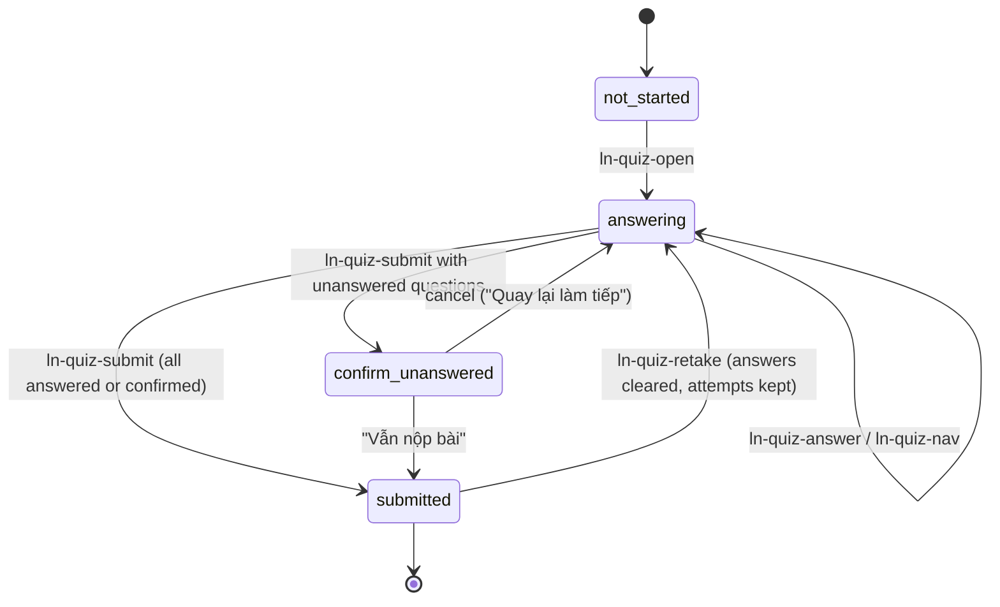

| Transition | Trigger | Guard | Side effects |
|---|---|---|---|
| not_started → answering | learner `ln-quiz-open` | — | quiz UI open, index 0 |
| answering → answering | `ln-quiz-answer`, `ln-quiz-nav` | — | answers saved (immediately) |
| answering → confirm | `ln-quiz-submit` | ≥1 unanswered | dialog "Còn N câu chưa trả lời" — "Câu chưa trả lời sẽ được tính là sai" |
| → submitted | `ln-quiz-submit` | — | `score = round(right / total × 100)`; `passed = score ≥ passingScore`; `submitted=true`; `attempts += 1`; toast pass/fail |
| submitted → answering | `ln-quiz-retake` ("Làm lại") | — | `submitted=false`, answers cleared; **old `score` shown until resubmission** |

- Passing score default `70` (seed). Result shows score ring, "Đạt"/"Chưa đạt", per-question review (your answer vs correct + explanation). Detailed answers are only available for the current attempt (text says "Kết quả từ lần làm trước (không lưu chi tiết từng câu)" otherwise).
- Quiz `passed` does not gate completion (§9 ⚠).
- AI-generated quiz questions (`aiGenerated`, `aiReviewed`): see §19.

---

## 11. Assignment submission

**Per-submission record (`submissions[]`):** `{id, courseId, lessonId, userId, submittedAt, fileName, link, note, status: pending|graded, score, maxScore, passScore, feedback, gradedAt, rubricScores?, history[]}`.
**Draft (per lesson, learner):** `draft[lessonId] = {link, note, fileName, resubmit}`.
**Upload state (transient):** `idle` | `uploading` (pct) | `done` | `error` (message).

```mermaid
stateDiagram-v2
    [*] --> not_submitted
    not_submitted --> uploading: ln-assign-file (file chosen; only if requiresFile)
    uploading --> upload_error: >20 MB or simulated failure
    upload_error --> uploading: ln-upload-retry
    uploading --> file_ready: upload complete (draft.fileName set)
    file_ready --> not_submitted: file removed (no action)
    not_submitted --> submit_gate: link/note typed
    file_ready --> submit_gate
    submit_gate --> pending: ln-assign-submit (button enabled only when required inputs present)
    pending --> pending: ln-assign-submit (edit while pending, same row updated)
    pending --> pending: ln-resubmit -> edit -> ln-assign-submit
    pending --> graded: lecturer tc-grade (score saved)
    graded --> graded: lecturer tc-grade edits score (reason required; history kept; learner notified)
    graded --> [*]
```

| Transition | Actor | Guard | Side effects |
|---|---|---|---|
| not → uploading | learner | file selected | upload progress shown |
| uploading → upload_error | system | size > 20 MB, or prototype failure | "Tệp vượt quá 20MB. Hãy nén lại hoặc nộp đường dẫn." / "Tải lên thất bại do mất kết nối." |
| submit gate | learner | `requiresFile` → file present; `requiresLink` → link present; if neither, file or link | button `Nộp bài tập` enabled only if gate passes and not uploading |
| link validity | `ln-assign-submit` | if link present must match `^https?://` | error toast "Đường dẫn chưa hợp lệ. Hãy bắt đầu bằng https://" |
| → pending | `ln-assign-submit` | gate passed | new submission row (or update existing pending row); `maxScore` default 10, `passScore` default 5; toast "Đã nộp bài tập. Bạn có thể hoàn thành bài học ngay." |
| pending → pending (resubmit) | learner `ln-resubmit` → edit → submit | status pending | same row updated; `submittedAt` refreshed |
| pending → graded | lecturer `tc-grade` | score within `0..maxScore` (or rubric per-criterion within points, total = sum) | `score`, `feedback`, `gradedAt`; notify learner "Bài tập đã được chấm" |
| graded → graded (edit) | lecturer `tc-grade` with changed score | `requireReason`; confirm "Học viên sẽ nhận thông báo điểm đã thay đổi" | previous score+feedback pushed to `history`; notify "Điểm bài tập đã được cập nhật" |
| graded → resubmit | — | **not allowed** (resubmit button only in `pending`) | — |

- Grade banner: "Đã chấm: x/max", pass if `score ≥ passScore`, lecturer feedback text, grading date, and "Bài đã chấm không nộp lại được trong bản thử nghiệm (giả định Q10)".
- Lesson completion counts any submission (§9).
- ⚠ conflict: PRODUCT Q10 (resubmission after grade) is open; code blocks it. PRODUCT Flow L8 "Resubmission = Q10" — use code's block until decided.
- Deadline/late policy text (`dueDays`, `latePenalty`) appears in the instructions but there is **no enforcement** in prototype.

---

## 12. Coding exercise attempt

**Entity:** `codeAttempts[]` per (user, lesson): `draft`, `submits`, `runs`, `passed`, `bestScore`, `solutionViewed`, `failedTests{testId: count}`, `lastRun{mode, phase, outcomes, logs}`, `tutorialStep`, `tutorialVisited[]`, `stepDrafts{}`, `stepRuns{}`.

**Run phases (`lastRun.phase`) — `run` result enum:** `done` | `syntax` | `runtime` | `timeout`.
**Per-test outcome:** `pass` (boolean) with `error` when the test could not run.
**UI attempt states (derived):** `idle` (no run yet) | `running` (run in flight, `running[key]`) | `runtime` (phase runtime) | `syntax` (phase syntax) | `timeout` | `failing` (phase done, some tests fail) | `passing` (all pass) | `passed-viewed-solution` (passed + solutionViewed).

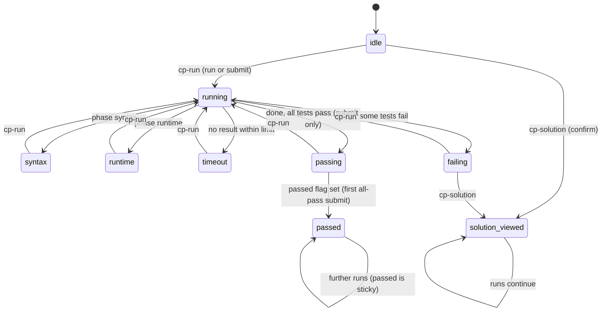

| Transition | Trigger | Guard | Side effects |
|---|---|---|---|
| idle → running | learner `cp-run` mode `run` ("Chạy", Ctrl/⌘+Enter) | not already running | runs **non-hidden** tests only; `runs += 1`; `lastRun` saved; `passed` not changed |
| idle → running | learner `cp-run` mode `submit` ("Nộp bài") | — | runs **all** tests; `submits += 1`; `bestScore = max(bestScore, pct)`; failing tests counted in `failedTests`; `failSubmits += 1` if not all pass |
| → passed | submit with all tests passing and `!passed` | — | `passed = true`; toast "Bạn đã đạt tất cả test! Giờ có thể hoàn thành bài học." → checklist `code` done |
| passed → passed | any later run | `passed` is sticky | — |
| any → solution_viewed | `cp-solution` (confirm: "Giảng viên sẽ thấy bạn đã xem lời giải trước khi đạt") | — | `solutionViewed = true`; mastery score capped at 70 |
| running → syntax/runtime/timeout | execution result | — | console shows error with explanation; chip "Lỗi cú pháp" / "Lỗi khi chạy" / "Quá thời gian"; "Hỏi AI về lỗi này" enabled |
| cp-reset | `cp-reset` (confirm "Code bạn đang viết sẽ được thay bằng code khởi đầu") | — | draft cleared, lastRun cleared (`passed` not reset) |

- Execution: sandboxed worker with timeout (main-thread fallback when workers are blocked). Python is **simulated** (passes only if code matches the reference solution).
- Test rows: pass/fail icon; failed row expands to Input · Expected · Received with the difference marked by colour + text.
- Tutorial lessons (`code.kind==='tutorial'`): per-step drafts/runs; step `isSolution` gated until `solutionViewed`; "done" when last step visited (`tutorialVisited` includes last index). Score for tutorial = 80 when done, else 0.
- Mastery score = `bestScore` (challenge), capped at 70 if solution viewed.

**⚠ conflicts**
- PRODUCT L6b: "resubmission rules … default: latest submission counts". Code: `bestScore` = **max** across submits; `passed` is sticky. Decide: best vs latest. The code is best-of.
- PRODUCT says "Nộp bài records the submission"; code's `submit` is the only path to `passed`, `run` is free. Consistent.

---

## 13. AI tutor (in-lesson assistant)

**Thread:** one per (user, lesson), max 40 messages, persisted. Message roles: `user` | `ai` | `limit` | `error`.
**Hint level:** `hintUsage[]` rows `{userId, courseId, lessonId, level 1..3, at}`; current level = max level for the lesson. Visible to lecturer; never affects score (decision 51).
**Diff suggestion:** `m.diff.state` enum: `null` (proposed) | `applied` | `skipped`.
**Vote:** `m.vote` `up` | `down` | null; down reasons: "Chưa đúng", "Khó hiểu", "Lộ lời giải", "Không liên quan bài".

**Turn state (`panel.busy`) and message states:**

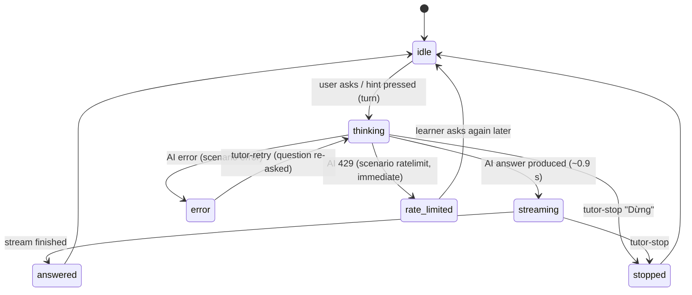

| Transition | Trigger | Guard | Side effects |
|---|---|---|---|
| idle → thinking | `tutor-send`, `tutor-ask` (starter/chip), `tutor-hint` | not busy | user message appended (except hint text) |
| idle → thinking (hint) | `tutor-hint` | `level = hintLevel + 1 ≤ 3`; code lessons only (button in hint bar) | `hintUsage.push({level})`; then turn with the hint ladder content |
| thinking → streaming | scenario `ok` after delay | — | AI message created, streamed word by word |
| streaming/thinking → stopped | `tutor-stop` ("Dừng") | busy | message marked stopped ("Bạn đã dừng câu trả lời này.") |
| → error | scenario `error` | — | error message with "Thử lại" and "Hỏi giảng viên" |
| → rate limited | scenario `ratelimit` | — | warn "Bạn đã hỏi quá nhiều trong thời gian ngắn" + "Hỏi giảng viên" |
| thinking (stuck) | scenario `thinking` | — | stays until user presses "Dừng" |
| error → retry | `tutor-retry` | — | removes error (and its user question), re-asks |

**Hint ladder (`HINT_NAMES`):** 1 "Hướng nghĩ" → 2 "Chỗ cần xem lại" → 3 "Khung cách làm". Each step is recorded; the button label shows `Gợi ý n/3`. Ladder content must never contain the full solution (G9).

**Diff suggestion (`tutor-diff`):**
- Proposal: ≤ 3 lines (prototype: 1 line "Đề xuất thêm 1 dòng · trước dòng N").
- `apply`: inserts line into editor; stores `original`; `state='applied'`; toast "Đã thêm 1 dòng … Hoàn tác".
- `undo`: restores exact `original`; `state=null`.
- `skip`: `state='skipped'` (no code change).
- After `applied`: "Chạy lại test" (`tutor-rerun`) triggers the submit button.
- Editor change dispatches input so coding-practice saves the draft.

**Escalation (`tutor-lecturer`):** dialog "Hỏi riêng giảng viên" — text min 10 characters; attachments checkboxes (code / failing test / AI summary of last 3 user messages). Creates `conversations[]` row (see §14).

**Context chips:** lesson, selected code range, error, failing test; each removable (`tutor-chip-off`). Context is what the AI reads — the learner always sees it.

- ⚠ conflict: PRODUCT Flow L6c describes a Socratic first question before hints; code's hint ladder starts at the explicit button. Treat the Socratic opener as answer-generation policy, not state.
- ⚠ conflict: PRODUCT L6c: hint ladder for "why is this wrong" questions in general; code ladder is only shown on code lessons.
- Thread clear: `tutor-clear` confirm (irreversible) clears only this lesson's thread.

---

## 14. Lesson Q&A and lecturer conversations

### 14.1 Public lesson questions (`questions[]`)

`status` enum: `unanswered` | `answered`. Replies `[{userId, isLecturer, text, at}]`.

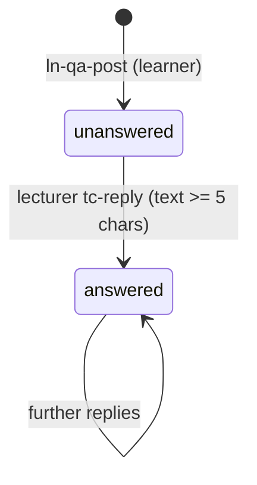

- Learner post: `ln-qa-post` → `unanswered`; no notification to lecturer in prototype (inbox count only).
- Lecturer reply `tc-reply`: `status='answered'`; notify learner "Câu hỏi đã có trả lời". Guard: text ≥ 5 characters.
- No resolve, no reopen on public questions. ⚠ PRODUCT Q20 (resolved for public Q&A?) is open.

### 14.2 Private conversations (`conversations[]`)

`status` enum (code): `open` | `resolved`. (PRODUCT's "Chờ giảng viên" is a derived label: open with no lecturer message.)
Fields: `fromAI`, `aiContext{summary, code, failingTest}`, `messages[{from: learner|lecturer, text, at}]`, `courseId`, `lessonId`, `learnerId`, `lecturerId`.

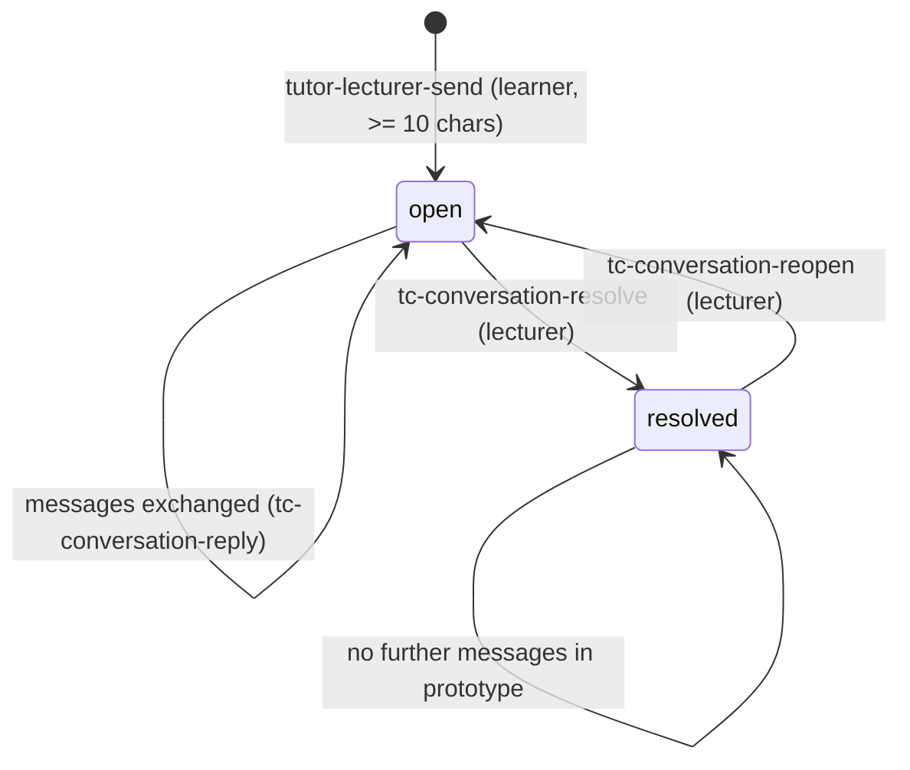

| Transition | Actor | Guard | Side effects |
|---|---|---|---|
| → open | learner (from AI tutor) | text ≥ 10 chars | `conversations.push` with `aiContext` per attachment checkboxes; notify lecturer "Câu hỏi riêng từ học viên" |
| open → open (message) | lecturer `tc-conversation-reply` | text ≥ 5 chars | message appended; notify learner "Có trả lời từ giảng viên" |
| open → resolved | lecturer `tc-conversation-resolve` | — (shown as "Đánh dấu đã giải quyết") | status `resolved` |
| resolved → open | lecturer `tc-conversation-reopen` | — | status `open` |

- PRODUCT (decision 56, Q34, L6d): either side can mark resolved; **lecturer must reply before marking resolved**; learner can reopen; learner can resolve only with a lecturer reply. ⚠ conflict: code lets the lecturer resolve with no reply check and gives the learner no resolve/reopen action. Implement PRODUCT's rule or record the decision.
- Visibility: private (never public Hỏi đáp). Lecturer inbox tag "Từ AI trợ lý".
- Learner-side waiting copy "Giảng viên thường trả lời trong 24 giờ" appears in the tutor panel; PRODUCT (Q34) says no expected reply time is promised. ⚠ conflict.

---

## 15. Course review (learner) and lecturer reply

**Entity:** `reviews[]` `{id, courseId, userId, stars 1..5, text (optional), createdAt, reply {text, at} | null}`. One per (user, course); a second submit is "Sửa đánh giá".

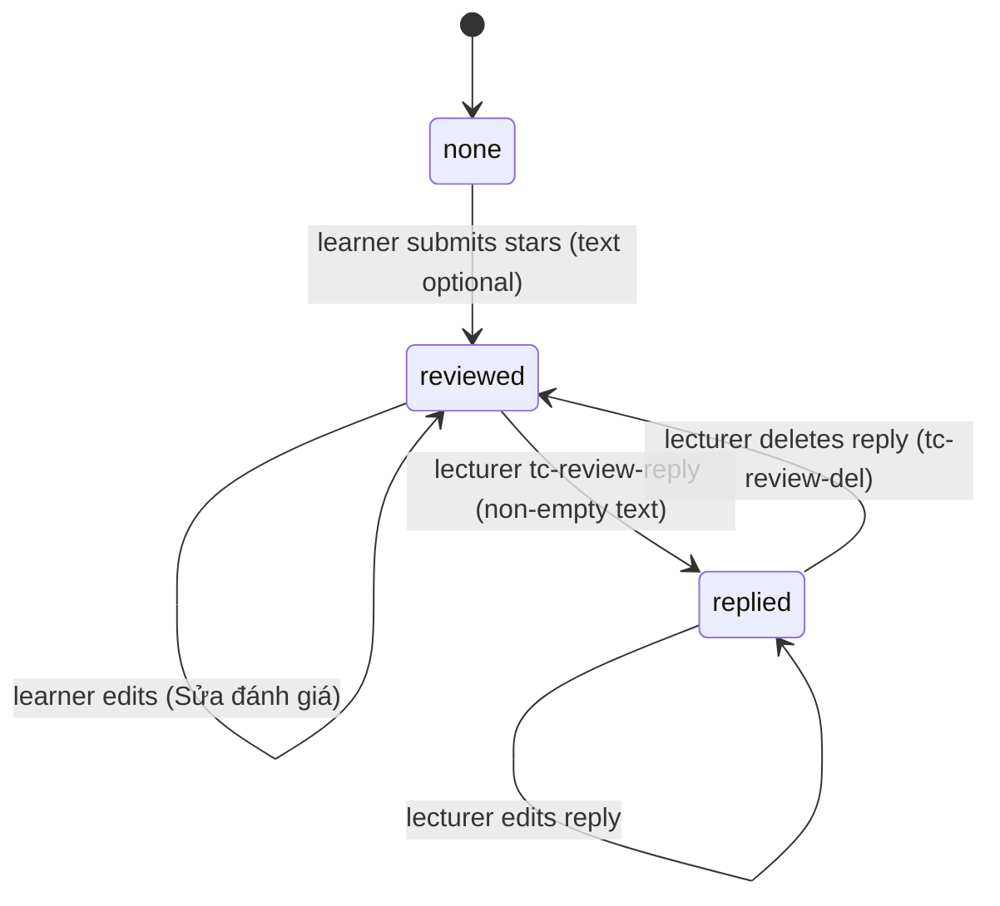

| Transition | Actor | Guard | Side effects |
|---|---|---|---|
| none → reviewed | learner, review sheet (`ln-review`, `openReview`) | ≥1 star | review visible on course detail; toast |
| reviewed → replied | lecturer `tc-review-reply` | reply text non-empty (form error otherwise) | `reply = {text, at}`; public under the review. Learner is not notified in the prototype. |
| replied → reviewed | lecturer `tc-review-del` (confirm) | — | `reply` removed |

- Star aggregate `rating`, `ratingCount`, `ratingBreakdown[5..1]` on the course are recomputed from reviews (prototype: stored on course seed; implementers must derive).
- ⚠ conflict: PRODUCT L9 says the review prompt appears at course completion; code exposes review in `ln-review` from course home/completion. Consistent enough.

---

## 16. Course lifecycle

**`courses[].status` enum (code):** `draft` | `pending` | `rejected` | `published` | `hidden`.
Plus `reviewOutcome` ∈ `changes` | `rejected` | `null` (why status is `rejected`), `rejectReason`, `hideReason`, `submittedAt`, `approvedAt`.

```mermaid
stateDiagram-v2
    [*] --> draft: tc-create (minimal form)
    draft --> pending: tc-submit (readiness all ok)
    rejected --> pending: tc-submit ("Sửa và gửi lại", readiness all ok)
    pending --> published: rv-approve (admin; price set)
    pending --> rejected: rv-request (reviewOutcome changes) or rv-reject (reviewOutcome rejected)
    published --> hidden: ad-hide (admin, reason required)
    hidden --> published: ad-unhide (admin, confirm)
    published --> published: admin price change (ad-price)
    draft --> draft: edits
```

| Transition | Actor | Guard | Side effects |
|---|---|---|---|
| [*] → draft | lecturer `tc-create` | title, summary, category, level valid | `price: 0`, `proposedPrice: null`, empty chapters/entryTest/concepts; `status='draft'`; `lecturerId` = creator |
| draft/rejected → pending | lecturer `tc-submit` (confirm) | `readiness(c)` all `ok` (§16.1) | `status='pending'`; `submittedAt`; `rejectReason` cleared; `startNextRound` if no in-review round (round carries flags); notify admin "Yêu cầu xuất bản mới" / "Gửi lại sau góp ý (lần N)" |
| pending → published | admin `rv-approve` (confirm "Duyệt và xuất bản") | `canApprove(round)` returns [] (§17); `price` valid (non-negative integer) | `status='published'`; `price` = admin price; round `approved`; notify lecturer "Khoá học đã được duyệt" |
| pending → rejected (changes) | admin `rv-request` | at least one `fix` criterion or open flag; **reason required** | `status='rejected'`, `reviewOutcome='changes'`, `rejectReason`; round `changes_requested`; notify lecturer |
| pending → rejected (rejected) | admin `rv-reject` | **reason required**; use for policy/quality | `status='rejected'`, `reviewOutcome='rejected'`; round `rejected`; notify lecturer |
| published → hidden | admin `ad-hide` (confirm, **reason required**) | — | `status='hidden'`, `hideReason`; new buyers blocked; existing learners keep access; notify lecturer |
| hidden → published | admin `ad-unhide` (confirm) | — | `status='published'`, `hideReason=null`; notify lecturer |
| published → published (price) | admin `ad-price` | price valid and ≠ current | `price` updated; pending orders keep their item price; notify lecturer "Giá khoá học đã thay đổi" |

- Lecturer edits: `locked` (read-only) while `pending` (`lecturer.js` `locked(c)`). Edits allowed in `draft`, `rejected`, `published` (⚠ PRODUCT Q12 open: re-review on published edit? prototype: no re-review; contentChanged may mark KMap stale).
- Lecturer status filter labels: Bản nháp / Chờ duyệt / Bị từ chối / Đã xuất bản / Đã ẩn (PRODUCT decision 24 matches).
- PRODUCT Q11 (delete course with learners): not implemented; `tc-delete-course` exists in lecturer module — treat deletion as out of state machine unless specified.

### 16.1 Completeness check (`readiness(c)`)

Lecturer submit is enabled only if all items `ok`:

| Item | Guard |
|---|---|
| Mô tả khoá học | `summary.trim().length ≥ 20` |
| Ít nhất 1 bài học | ≥ 1 lesson |
| Giá đề xuất | `proposedPrice` not null (admin sets final price) |
| Bài kiểm tra đầu vào | `entryTest.questions.length ≥ 5` (`ENTRY_MIN`) |
| Bản đồ kiến thức đã xác nhận | `knowledgeMap.status === 'confirmed'` |
| Bài code có test và lời giải chạy đạt | each challenge has ≥ 1 test and `solutionCheck.ok` (only if challenges exist) |
| Câu hỏi do AI tạo đã được duyệt | no quiz question with `aiGenerated && aiReviewed === false` (only if AI questions exist) |
| Bài tập có thang chấm | every assignment has a `rubric` (only if assignments exist) |

- ⚠ conflict: PRODUCT §5 T3 lists price, description (no length), ≥1 lesson, entry test, KMap confirmed. Code adds code/AI/rubric items and a 20-char description minimum. PRODUCT Q1 (who sets the price) is resolved in code as: lecturer proposes (`proposedPrice`), admin sets final `price` at approval.
- ⚠ conflict: PRODUCT §2.5 "Publication completeness check: price, description, ≥1 lesson." Code requires more (above). Keep code list as the prototype contract; update PRODUCT.

---

## 17. Publication review rounds, criteria and flags

**Round entity (`courseReviews[]`):** `{id, courseId, round (1..n), status, submittedAt, decidedAt, reviewerId, note, criteria{id: {status, note}}, flags[]}`.

**Round status enum:** `in_review` | `changes_requested` | `rejected` | `approved`
(UI labels: "Đang duyệt", "Yêu cầu sửa", "Từ chối", "Đã duyệt".)

**Criteria** (`CRITERIA`, 7 items, each `status` ∈ `pass` | `fix` | `na` | `null` (unmarked)):
`info` (Mô tả, đối tượng, giá đề xuất) · `materials` (video/slide/tài liệu) · `quiz` (đáp án đúng, giải thích) · `entry` (bài kiểm tra đầu vào ≥ 5 câu) · `code` (test + lời giải) · `assignment` (yêu cầu + thang chấm) · `rights` (bản quyền — always needs human mark).
Auto-suggestion `autoCriteria(c)` returns a suggested status + reason; admin applies with "rv-crit-auto" (only fills unmarked). `rights` has no auto-status.

**Flag entity (inside round):** `{id, target{type, lessonId?, itemId?, label}, severity: must|should, comment, status: open|fixed|closed, reply, source: admin|ai, carried?}`.
- Severity labels: `must` = "Bắt buộc sửa", `should` = "Nên sửa".
- Flag status labels: `open` = "Đang mở", `fixed` = "Giảng viên đã sửa", `closed` = "Đã đóng".

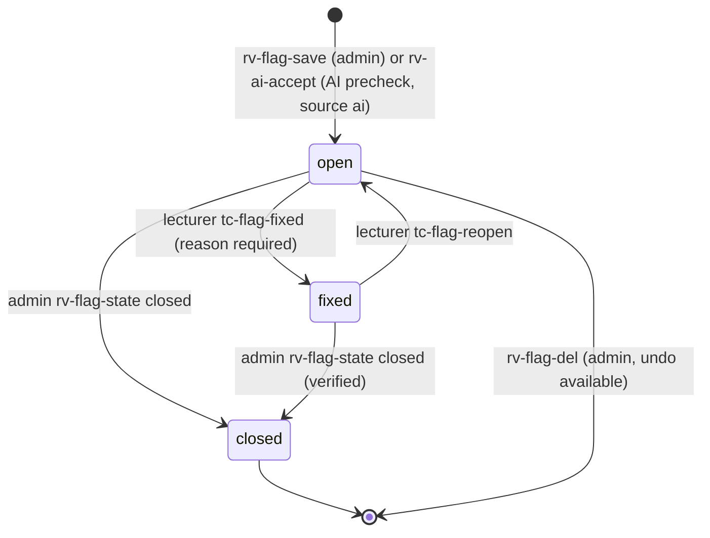

**Round lifecycle:**

```mermaid
stateDiagram-v2
    [*] --> in_review: pending course opens round (ensureRound / startNextRound)
    in_review --> changes_requested: rv-request (fix criteria or open flags; reason)
    in_review --> rejected: rv-reject (reason)
    in_review --> approved: rv-approve (canApprove empty)
    changes_requested --> in_review: lecturer tc-submit again (new round, flags carried)
    rejected --> in_review: lecturer tc-submit again (new round)
    approved --> [*]
```

**canApprove(round) — blocking reasons (empty list = can approve):**
1. Any criterion has no status (`null`/unmarked): "Còn N tiêu chí chưa chấm."
2. Any criterion with status `fix`: "N tiêu chí đang ở 'Cần sửa'."
3. Any flag with `severity === 'must'` and `status !== 'closed'`: "N cờ 'Bắt buộc sửa' chưa đóng."
- `should` flags never block. `na` counts as marked.

**Request changes (`rv-request`) guard:** at least one `fix` criterion or one non-closed flag; otherwise toast "Chưa có tiêu chí 'Cần sửa' hay cờ nào…". Reason required.

**Carry-over on resubmit (`startNextRound`):** criteria copied from previous round; flags not `closed` are copied with `carried: true`. Lecturer's `fixed` flags are shown to admin for verification.

**Lecturer view:** `lecturerRound` = newest decided round (or in-review). Lecturer marks flags fixed with a reply (required) → `fixed`; can reopen → `open`.

- ⚠ conflict: PRODUCT Q29 (automatic copyright/sensitive checks, advisory vs blocking) is open. Code has `aiPrecheck` (advisory suggestions adding `source:'ai'` flags) — advisory only; `rights` criterion still human-marked.
- ⚠ conflict: PRODUCT §5 T3 requires submit disabled until all requirements pass — implemented (§16.1). Admin approve is blocked by §17 canApprove, not by lecturer readiness — both enforced.

---

## 18. Knowledge map (AI extraction + lecturer review)

**Map status enum (`knowledgeMaps[courseId].status`):** `empty` | `ready` | `analysing` | `failed` | `confirmed` | `stale`
(⚠ data.js header lists only `analysing|ready|confirmed|failed|stale`; code also uses `empty` for a course with no lessons.)

**Concept review (`concepts[].review`):** `suggested` | `accepted` | `edited` | `declined` (labels: "Đề xuất", "Đã chấp nhận", "Đã sửa", "Đã bỏ").
**Edge review (`edges[].review`):** same enum.

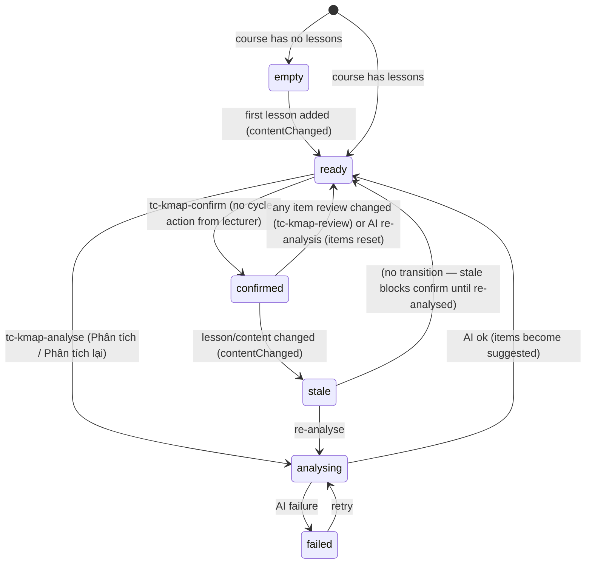

**Item review transitions** (per concept or edge):

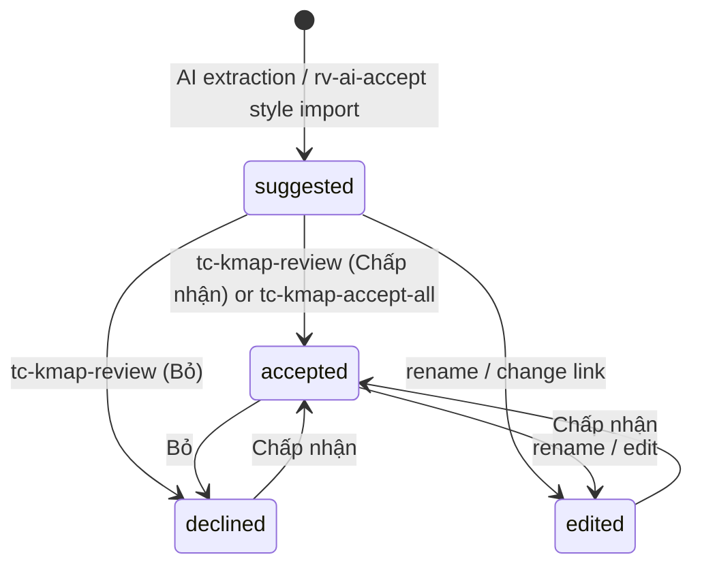

| Transition | Actor | Guard | Side effects |
|---|---|---|---|
| ready → analysing | lecturer `tc-kmap-analyse` | — | status `analysing` (spinner "Đang phân tích nội dung…") |
| analysing → ready | system | prototype scenario `ok` | first run: one concept per lesson (name = lesson title minus numbering), edges chain prerequisites in lesson order, all `suggested`; re-run: keep concepts, reset all `review='suggested'`, drop lesson links that no longer exist; notify lecturer "Bản đồ kiến thức đã sẵn sàng" |
| analysing → failed | system | scenario `fail` | banner "Phân tích bản đồ kiến thức thất bại" + retry |
| ready/confirmed → confirmed | lecturer `tc-kmap-confirm` | **`findCycle(m)` must be null** (UI also disables button) | `status='confirmed'`; `course.concepts` = non-declined concepts; `course.prerequisites` = active edges; each lesson's `conceptIds` recomputed |
| confirmed → ready | lecturer changes any item review | — | status `ready` (must re-confirm) |
| ready/confirmed → stale | system `contentChanged` (any lesson/content edit) | status confirmed | toast "Nội dung đã đổi: bản đồ kiến thức cần phân tích lại." |
| empty → ready | system `contentChanged` | lessons exist | — |
| item: suggested → accepted | lecturer `tc-kmap-review` / `tc-kmap-accept-all` | accept-all: all `suggested` → `accepted` | — |
| item: → declined | lecturer | — | declined concepts/edges excluded from `activeEdges` and from confirm |

**Cycle detection (`findCycle`):**
- DFS over `activeEdges` (edges whose endpoints are not declined). Returns the loop path (e.g. `A → B → C → A`).
- Guard: confirm disabled, banner names the loop with "Xem trên sơ đồ"; graph marks loop nodes and closing edge (colour + icon); list flags offending links.
- AI-suggested cycle edges (scenario `cycle`) are added as `suggested`. They must **not** be auto-accepted.

- ⚠ conflict: PRODUCT T2: "Chấp nhận tất cả" must open a summary confirmation ("Thêm 12 khái niệm và 9 liên kết tiên quyết · Bỏ qua 2 liên kết (tạo vòng lặp)") then Xác nhận. Code: `tc-kmap-accept-all` accepts **all** suggested items immediately (including the cycle-closing edge) with a toast; no summary dialog. Since confirm is blocked by cycles, the outcome is still safe, but the "never auto-accepted" rule is violated by accept-all. Implement the summary and exclude cycle-creating edges from accept-all.
- ⚠ conflict: PRODUCT Flow T2 "Xác nhận bản đồ" required for publication (A4) — implemented as readiness item.
- Graph vs list: graph default (decision 43); list is the accessible equivalent.

---

## 19. AI-generated drafts (lecturer)

Two flows share the same principle: **nothing the AI produces reaches learners until the lecturer accepts it.**

### 19.1 AI course/lesson draft (`lecturer-ai-create.js`)

**Flow steps (`cr.step`):** `form` → `generating` → `review` → applied (closes) | `error` | `limit` | discard (closes without applying).

```mermaid
stateDiagram-v2
    [*] --> form
    form --> generating: generate (topic required)
    generating --> review: AI done
    generating --> error: AI error (scenario error)
    generating --> limit: rate limit
    error --> generating: retry
    limit --> form: back
    review --> applied: apply (accepted items only)
    review --> discarded: close/discard (nothing written)
    applied --> [*]
    discarded --> [*]
```

**Item states (question/lesson-part drafts):** `pending` ("Chờ duyệt") | `accepted` ("Đã chấp nhận") | `discarded` ("Đã bỏ").

| Transition | Actor | Guard | Side effects |
|---|---|---|---|
| form → generating | lecturer | topic non-empty (kind `code` or `lesson`) | AI task |
| review: item pending → accepted/discarded | lecturer | — | — |
| apply | lecturer | — | chapter created if none; lesson (`code` kind → `type:'code'`, `aiDraft: true`; `lesson` kind → quiz with **accepted** questions only, `aiReviewed:true`); `contentChanged(course)` (may mark KMap stale); navigate to editor (code: the code editor) |
| discard | lecturer | — | no write |

### 19.2 AI import into existing lesson (`lecturer-ai.js`, file import)

**Result states per item:** questions `pending|accepted|discarded`; concepts `pending|accepted`; summary `accepted` or not.
- `apply()`: writes `lesson.material`; `reading = summary` if accepted; **accepted** questions appended to quiz with `aiReviewed:true`; accepted concepts added to KMap as `suggested` (KMap `confirmed` → `ready`); `contentChanged(course)`.
- Questions generated by the prototype carry `aiGenerated: true, aiReviewed: false` until accepted. Publication readiness counts unreviewed AI questions (§16.1).
- "Chấp nhận tất cả" accepts all non-discarded questions.

**Grading AI (`tc-grade-ai`, lecturer.js):** suggests score/feedback for a submission; the lecturer must review and save via `tc-grade`. AI never writes a grade (G5).

---

## 20. Grading (assignment submissions)

**Submission status enum:** `pending` | `graded`. Queue tabs "Chờ chấm" (`pending`) and "Đã chấm" (`graded`).

```mermaid
stateDiagram-v2
    [*] --> pending: learner submits (ln-assign-submit)
    pending --> graded: tc-grade (valid score)
    graded --> graded: tc-grade edit (reason required; history kept)
    pending --> pending: learner resubmits while pending
```

| Transition | Actor | Guard | Side effects |
|---|---|---|---|
| pending → graded | lecturer `tc-grade` | score `0..maxScore` (or rubric per criterion within `points`, total = sum, rounded to 0.1); rubric must have every criterion | `score`, `feedback`, `gradedAt`, `rubricScores`; notify learner "Bài tập đã được chấm"; next/return navigation |
| graded → graded (score changed) | lecturer `tc-grade` | `requireReason`; confirm "Sửa điểm bài đã chấm" | previous `{oldScore, feedback, at}` pushed to `history`; notify learner "Điểm bài tập đã được cập nhật" |
| graded → graded (feedback only, same score) | lecturer | no confirm, no history entry | notify learner (same notification path) |

- Grading is one submission at a time (decision 25); batch scoring is not supported (Q25 recommendation (b): only non-scoring bulk actions — not implemented).
- "Mẫu nhận xét" snippets with placeholders `{{ten_hoc_vien}}`, `{{diem}}`; create/edit/delete with undo (`tc-snippet-*`).
- ⚠ conflict: PRODUCT Q30 asks whether learners are notified and the old grade kept. Code: yes to both (history + notify) — resolved in code.
- ⚠ Q9/Q10 interplay: graded submissions cannot be resubmitted by the learner (§11).

---

## 21. User account

**`users[].status` enum:** `active` | `inactive`
**`users[].role` enum:** `learner` | `lecturer` | `admin`
**Deactivation record:** `deactivation {reason, at, by}` (reason visible only to admins — "Lý do (chỉ quản trị viên xem được)").

```mermaid
stateDiagram-v2
    [*] --> active
    active --> inactive: ad-deactivate (admin, impact dialog, reason required, consent)
    inactive --> active: ad-reactivate (admin, confirm)
    active --> active: ad-role (role change, confirm)
```

| Transition | Actor | Guard | Side effects |
|---|---|---|---|
| active → inactive | admin `ad-deactivate` | not self (self row shows "Tài khoản của bạn"); reason required; checkbox "Tôi hiểu tác động" required | `status='inactive'`, `deactivation={reason, at, by}`; **prototype does not sign the user out and does not block sign-in** (see ⚠) |
| inactive → active | admin `ad-reactivate` | — | `status='active'`, `deactivation=null` |
| role change | admin `ad-role` (select) | confirm "Đổi vai trò … Thay đổi có hiệu lực ở lần tải trang tiếp theo" | `role` updated; UI select reverted on cancel |

**Deactivation impact dialog (counts shown before reason):**
- "N khoá học đang sở hữu" = enrolments in published courses.
- "N đơn hàng chờ thanh toán" = pending orders.
- "Đang giảng dạy N khoá học" = published courses with this lecturer.
- Consequence text (PRODUCT): logout from all devices, cannot sign in, data and orders kept, reactivation possible.

- ⚠ conflict: deactivation is described to the admin as "đăng xuất khỏi mọi thiết bị", but `core.js` sign-in / `currentUser()` have **no check on `users[].status`** (grep: no `inactive` in core/learner/lecturer). Implement the block in the real app (sign-in + session revocation). This is a prototype gap, not product intent.
- ⚠ Q15 (is reason mandatory and shown to the user?): code requires reason, shown to admin only.
- Role change is not validated against content ownership (a lecturer demoted keeps `lecturerId` on courses). Real app must define behavior (open question, not in PRODUCT).
- Admin "Tài khoản bị vô hiệu hoá" dashboard tile counts inactive users (link to filtered list).

---

## 22. Notifications

**Entity:** `notifications[]` `{id, userId, title, body, link, read, createdAt}`. `read` toggled by `notif-open` / `notif-read-all`.

Events that create notifications in the prototype (recipient → title):

| Event (source) | Recipient | Title (verbatim) |
|---|---|---|
| Payment confirmed (`markPaid`) | buyer | "Thanh toán thành công" |
| Lesson completed, path updated (`ln-complete`) | learner (self) | "Lộ trình đã được cập nhật" |
| Lecturer replies to public question (`tc-reply`) | learner | "Câu hỏi đã có trả lời" |
| Lecturer replies to private conversation (`tc-conversation-reply`) | learner | "Có trả lời từ giảng viên" |
| Learner escalates from AI tutor (`tutor-lecturer-send`) | lecturer | "Câu hỏi riêng từ học viên" |
| Assignment graded (`tc-grade`, first time) | learner | "Bài tập đã được chấm" |
| Assignment grade edited (`tc-grade`, graded again) | learner | "Điểm bài tập đã được cập nhật" |
| Course submitted (`tc-submit`) | admin | "Yêu cầu xuất bản mới" / "Gửi lại sau góp ý (lần N)" |
| Course approved (`rv-approve`) | lecturer | "Khoá học đã được duyệt" |
| Changes requested (`rv-request`) | lecturer | "Khoá học cần chỉnh sửa" |
| Course rejected (`rv-reject`) | lecturer | "Khoá học bị từ chối" |
| Course hidden (`ad-hide`) | lecturer | "Khoá học đã bị ẩn" |
| Course unhidden (`ad-unhide`) | lecturer | "Khoá học đã hiện lại" |
| Price changed (`ad-price`) | lecturer | "Giá khoá học đã thay đổi" |
| Knowledge map ready (`runAnalysis`) | lecturer | "Bản đồ kiến thức đã sẵn sàng" |

- Not notified in prototype: order cancelled/expired (`failed`), path generation failure, role change, deactivation, review reply, public question post (learner → lecturer), lecturer's course-review reply.
- ⚠ conflict: PRODUCT Q17 (which events; email too?) is open. Code: in-app only. PRODUCT §6 S40 lists "payment confirmed, assignment graded, question answered, publication approved/rejected, path updated" — all present except "rejected" is split into request-changes + reject (both notify).
- PRODUCT §5 L3 expired/underpaid: no notification in code. Real app: decide.

---

## 23. Prototype-only — do NOT implement

These are artifacts of the prototype. Their real-world equivalents are noted so the implementer knows what the real app must handle.

### 23.1 Dev drawer scenario flags (`Codi.state.scenario`)

| Flag | Values | Real-world condition the app must handle |
|---|---|---|
| `paymentOutcome` | `success` · `expired` · `underpaid` · `slow` · `qrfail` | `success`: bank webhook confirms full amount. `expired`: no payment within 30 min. `underpaid`: partial transfer (`received < total`). `slow`: bank latency (must show "after a while" guidance, no endless spinner — G10). `qrfail`: VietQR image cannot be generated/loaded → text fallback. |
| `pathAI` | `ok` · `fail` | AI path generation error or timeout → default order + retry (G8). |
| `materials` | `ok` · `error` | Video/PDF cannot load → retry + reading text available. |
| `aiAssistant` | `ok` · `ratelimit` · `error` · `thinking` | Tutor/AI provider 429, 5xx, or hung request (user must be able to Dừng). |
| `kmap` | `ok` · `fail` · `cycle` | KMap extraction failure (retry) and AI-suggested cycles (must block confirm). |
| `theme` | `light` · `dark` | UI only. |

### 23.2 localStorage persistence

- Key `codi-proto-v5` holds the whole `Codi.state` (db + carts + scenario + module slices). Version mismatch → reseed.
- Real app: server-side DB. Do not replicate `Codi.state` shape; the entity shapes in `js/data.js` header are the reference, and the state enums in this file are normative.
- Timers (`sim`, `videoTimer`, `running`, `upload`, `genPending`) are in-memory; real app must persist the authoritative state (order status, upload status, submission status) and derive the rest.

### 23.3 Seed data

- `js/data.js` (`CodiData`) is fictional sample content (users, courses, orders, the learner's study state `learnerSeed`). Do not migrate it. Seed users: learner, lecturer, admin with fictional names; bank info is a placeholder.
- Seed course statuses (`draft`, `published`, etc.) show the enum only.

### 23.4 `Codi.wait` and fake latency

- Fixed `setTimeout` delays stand in for real work: payment check (~6 s), AI turn (~0.9 s), path generation (~2.8 s), KMap analysis (~2.5 s), AI draft (~1.3–1.5 s), upload progress (300 ms steps), tutorial/copy feedback (400–900 ms), manual-check cooldown (30 s). Real values come from the backend; keep the states, not the timings. Always show the state, never a bare spinner, after a threshold (PRODUCT §7.3).
- `Math.random()` order codes (`CODI#####`) and `Date.now()` ids are prototype-only; real app uses DB ids plus collision-safe order codes.

### 23.5 Simulated uploads and execution

- Upload failure is triggered by file size > 20 MB or a filename containing "loi". Real app: real storage errors.
- Coding execution in-browser (worker/main-thread) and Python simulated by matching the reference solution. Real app must run tests in a server or sandboxed runner; Python must not be "simulated" in production.

### 23.6 Mock URLs and contacts

- `hotro@codi.vn`, "minh hoạ trong bản thử nghiệm" QR caption, "Bản thử nghiệm" toasts: placeholders.

---

## 24. Open decisions (must be resolved before implementing the affected state)

| ID | Topic | Current code behavior | PRODUCT position | Blocks |
|---|---|---|---|---|
| D1 | Order expiry duration (Q4) | 30 min from `createdAt`, then `failed` | Q4 open | §5 |
| D2 | Late payment after expiry | Support email; no auto-honour | Q4 open | §5 |
| D3 | Underpaid/overpaid/wrong content (Q5) | Partial case only | open | §5 |
| D4 | Mua ngay destination (decision 42) | Adds to cart, goes to `/cart` | checkout, cart unchanged | §2, §3 |
| D5 | "Tôi đã chuyển khoản" feedback | Modal + 30 s cooldown | inline "Chưa nhận được tiền" | §5.5 |
| D6 | Quiz pass required for completion? (Q9) | Submit only | pass not stated; retakes open | §9, §10 |
| D7 | Best vs latest coding submission | Best-of (max) | latest counts (L6b default) | §12 |
| D8 | Resubmit after grade (Q10) | Blocked | open | §11 |
| D9 | Conversation resolve rules (decision 56, Q34) | Lecturer may resolve without reply; no learner actions | reply required; learner can resolve/reopen | §14 |
| D10 | Accept-all in KMap | Accepts cycle-closing edges; no summary | summary dialog, cycles excluded | §18 |
| D11 | "Để sau" after an AI path | Resets to default order | keep personalised path (implied) | §7, §8 |
| D12 | Deactivation enforcement | Flag only, no sign-in block | logout everywhere | §21 |
| D13 | Price change confirmation | Modal, no reason | confirm + reason (§7.12) | §16 |
| D14 | Voucher scope/stacking (Q16) | single voucher, no scope | open | §4 |
| D15 | Notification channels (Q17) | in-app only, list in §22 | open | §22 |
| D16 | Mastery model | heuristic 1–4 scale | BKT | §8, §9 |
| D17 | Published-course edit → re-review (Q12) | no re-review; KMap marked stale | open | §16 |
| D18 | Refund flow | none | non-goal (learner UI) | §5 |

---

## 25. Source map (quick reference)

| Area | Files / functions |
|---|---|
| Ownership, cart selector, enrolment, gating | `js/core.js` (`ownership`, `enroll`, `isEnrolled`, `cart`, `setCart`, `pendingOrderFor`, `requireAuth`, `notify`, `courseProgress`) |
| CTA, cart, voucher, checkout, payment poll, cancel, new code, manual check | `js/learner-commerce.js` (`ctaFor`, `purchaseCard`, `purchaseCardDetail`, `addToCart`, `checkVoucher`, `cartSummary`, `createOrderFromCart`, `cancelOrder`, `markPaid`, `startSim`, route `/checkout`, route `/cart`, `cm-*` actions) |
| Goal, fork, diagnostic, path, lock, checklist, completion, quiz, assignment, upload | `js/learner-learning.js` (`newRecord`, `lockInfo`, `lessonStatus`, `checklist`, `generatePath`, `ln-complete`, `ln-quiz-*`, `ln-assign-*`, `ln-diag-*`, `ln-fork-*`, `ln-goal-*`, `ln-make-path`) |
| Code exercise | `js/coding-practice.js` (`status`, `score`, `run`, `grade`, `cp-run`, `cp-solution`, `cp-reset`) |
| AI tutor | `js/ai-tutor.js` (`turn`, `hintLevel`, `tutor-hint`, `tutor-diff`, `tutor-stop`, `tutor-retry`, `tutor-lecturer-send`) |
| Lecturer course/KMap/grading/Q&A/reviews | `js/lecturer.js` (`readiness`, `kmapOf`, `runAnalysis`, `findCycle`, `contentChanged`, `tc-submit`, `tc-kmap-*`, `tc-grade`, `tc-reply`, `tc-conversation-*`, `tc-review-reply`, `tc-flag-*`) |
| Lecturer coding builder | `js/lecturer-coding.js` (save action derives `solutionCheck` from a fresh run; challenge publishes only with `solutionCheck.ok`) |
| AI drafts | `js/lecturer-ai.js` (`task`, `generateQuestions`, `apply`), `js/lecturer-ai-create.js` (`generate`, `apply`) |
| Publication rounds, criteria, flags, approve/reject | `js/course-review.js` (`CRITERIA`, `ensureRound`, `startNextRound`, `canApprove`, `autoCriteria`, `aiPrecheck`), `js/admin-review.js` (`rv-*`) |
| Admin course hide/unhide, price, users, orders, vouchers | `js/admin.js` (`ad-hide`, `ad-unhide`, `ad-price`, `ad-role`, `ad-deactivate`, `ad-reactivate`, `ad-voucher-*`, `ad-order-*`) |
| Seed / entity shapes | `js/data.js` (header comment), `js/core.js` (header comment, scenario flags) |

Product intent: `docs/mockup/PRODUCT.md` §2.5, §5 (L3, L4, L5, L6, L6b, L6c, L6d, L7, L8, L9, T1–T4, D1), §6 (S05–S41), §7 (1–27), §10 (decisions 1–56), §11 (assumptions A1–A8, Q1–Q34).
