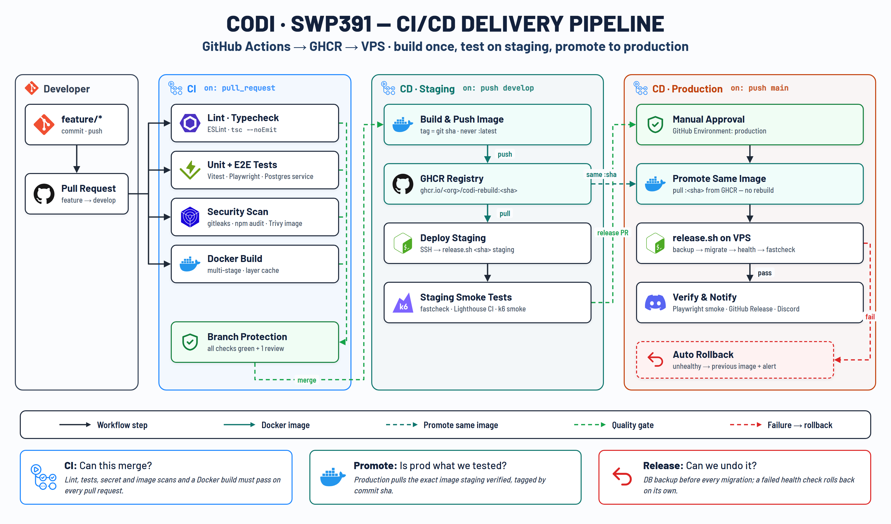
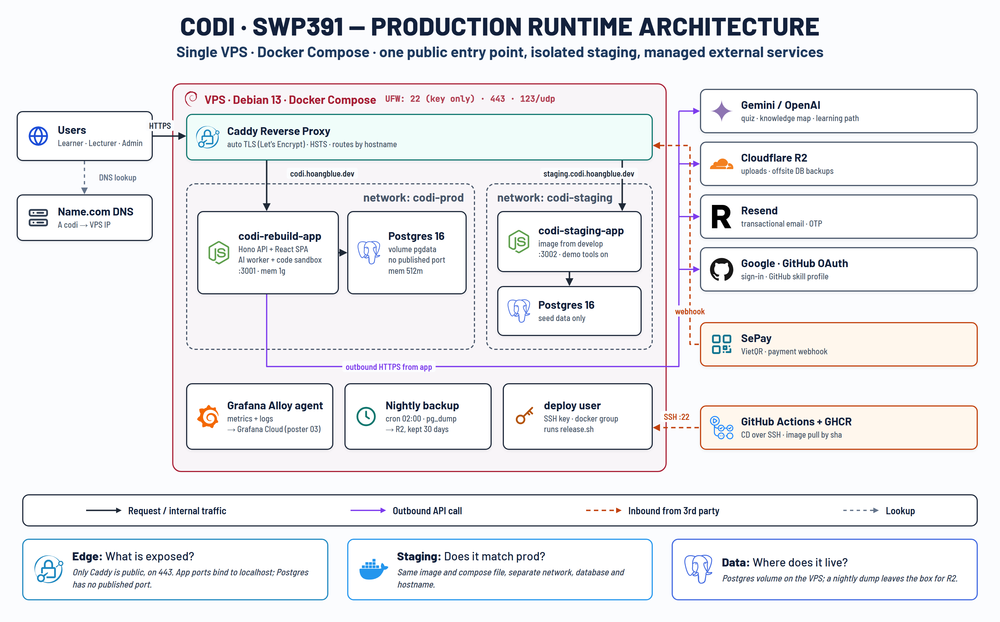
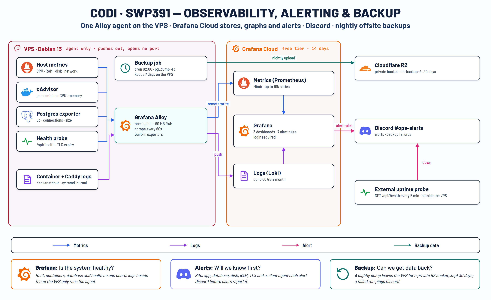
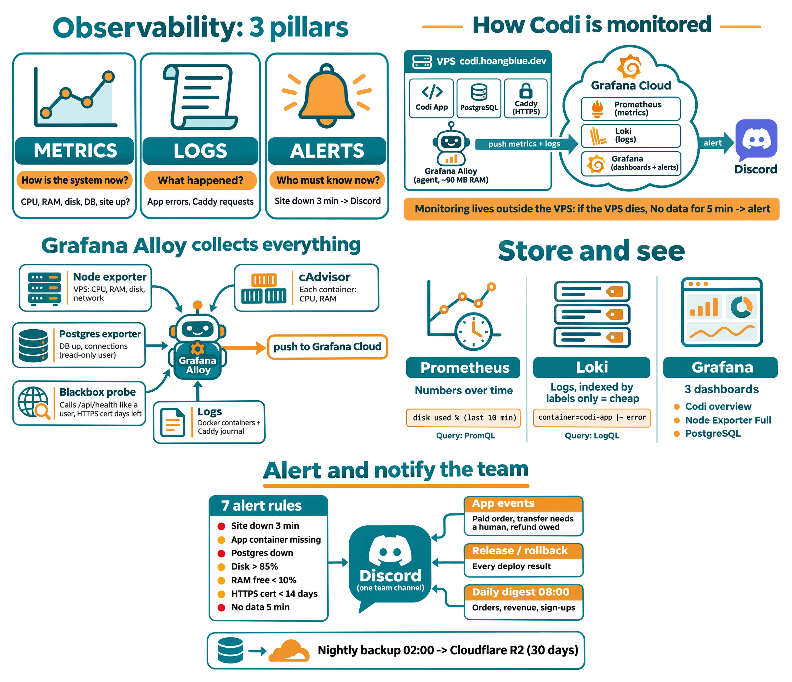

# Kiến trúc hệ thống

Ba sơ đồ mô tả cách Codi được đưa lên server, chạy trên VPS và được giám sát. Sơ đồ vẽ **kiến trúc mục tiêu**; bảng
dưới mỗi sơ đồ ghi rõ phần nào đã chạy thật (kiểm tra ngày 2026-11-04) và phần nào còn là kế hoạch.

| Sơ đồ | Nội dung |
|---|---|
| [01-cicd-pipeline.png](01-cicd-pipeline.png) | Đường đi của code từ pull request tới production |
| [02-production-runtime.png](02-production-runtime.png) | Các thành phần chạy trên VPS và dịch vụ bên ngoài |
| [03-observability-and-backup.png](03-observability-and-backup.png) | Giám sát, cảnh báo và sao lưu |
| [04-observability-explained.png](04-observability-explained.png) | Giải thích giám sát cho người mới: 3 trụ cột, Alloy thu gì, Prometheus/Loki/Grafana, cảnh báo Discord |

## 1. CI/CD

| Thành phần trong sơ đồ | Hiện trạng |
|---|---|
| CI trên mọi pull request: typecheck, unit test, E2E Playwright, quét bảo mật, Docker build | **Đã có** ([ci-cd.yml](../../.github/workflows/ci-cd.yml), [ci-cd.md](../ci-cd.md)). Quét bảo mật dùng `security:check` (secret, `npm audit`) và security probe; chưa có gitleaks và Trivy. Chưa có ESLint |
| Branch protection (mọi check xanh, 1 review) | **Không bật** (quyết định của nhóm, 2026-11-04): CI vẫn chạy trên mọi PR và chặn deploy khi đỏ, nhưng không chặn nút merge |
| Build image một lần, đẩy lên GHCR, staging và production kéo cùng image | **Chưa**: job deploy build image rồi truyền thẳng qua SSH lên VPS |
| CD staging khi push `develop` | **Chưa** có môi trường staging; push `develop` chỉ chạy CI |
| CD production khi push `main`: `release.sh` (backup, migrate, health, fastcheck) | **Đã có** |
| Duyệt tay trước khi deploy (GitHub Environment `production`) | Environment đã có và giữ secret deploy; **chưa** cấu hình người duyệt |
| Tự rollback khi release lỗi | **Đã có**: health check hoặc fastcheck lỗi thì quay về image trước; migration lỗi thì dừng trước khi đổi image |
| Kiểm tra sau deploy và thông báo | **Đã có**: fastcheck qua Caddy, Playwright fast check, security probe; mỗi release và rollback báo Discord. Chưa tạo GitHub Release |

## 2. Production runtime

| Thành phần trong sơ đồ | Hiện trạng |
|---|---|
| Caddy là cổng public duy nhất, TLS tự động, HSTS | **Đã có** |
| `codi-rebuild-app` (Hono API, React SPA, AI worker) lắng nghe `127.0.0.1:3001`, giới hạn 1 GB | **Đã có** |
| Postgres 16 không mở cổng ra ngoài, giới hạn 512 MB | **Đã có** |
| UFW chỉ mở 22, 443, 123/udp | **Đã có**. SSH vẫn nhận mật khẩu và đăng nhập `root` (sơ đồ ghi "key only") |
| Môi trường staging (`staging.codi.hoangblue.dev`, network riêng) | **Chưa có** |
| User `deploy` riêng cho CI | **Chưa**: CI dùng key riêng `github-actions-codi-deploy` nhưng đăng nhập bằng `root` |
| Grafana Alloy, backup đêm, dịch vụ ngoài (Gemini/OpenAI, R2, Resend, OAuth, SePay) | **Đã có** |

## 3. Giám sát, cảnh báo và sao lưu

| Thành phần trong sơ đồ | Hiện trạng |
|---|---|
| Một agent Grafana Alloy trên VPS (host, container, Postgres, health probe, log), đẩy lên Grafana Cloud | **Đã có** ([deploy/monitoring](../../deploy/monitoring/)) |
| Backup 02:00 bằng `pg_dump`, giữ 7 ngày trên VPS, 30 ngày trên R2 | **Đã có** (`/etc/cron.d/codi-backup`, [backup-offsite.sh](../../deploy/backup-offsite.sh)) |
| Cảnh báo về Discord | **Đã có** cho release, rollback và backup lỗi; báo cáo ngày lúc 08:00 ([daily-digest.sh](../../deploy/daily-digest.sh)) |
| Dashboard và alert rule trên Grafana | Theo cấu hình [provision-grafana.mjs](../../deploy/monitoring/provision-grafana.mjs) |

Bản giải thích từng phần (dùng khi thuyết trình):

Chi tiết vận hành: [deployment.md](../deployment.md). Hiệu năng và bảo mật đã đo: [README](../../README.md).

## Việc còn lại để khớp sơ đồ

1. Tắt đăng nhập SSH bằng mật khẩu, tạo user `deploy` cho CI thay cho `root`.
2. Thêm người duyệt cho environment `production`.
3. Đẩy image lên GHCR và dựng môi trường staging khi push `develop`.
4. Thêm gitleaks, Trivy và ESLint vào CI.

Branch protection được cố ý không bật (xem bảng CI/CD ở trên).
