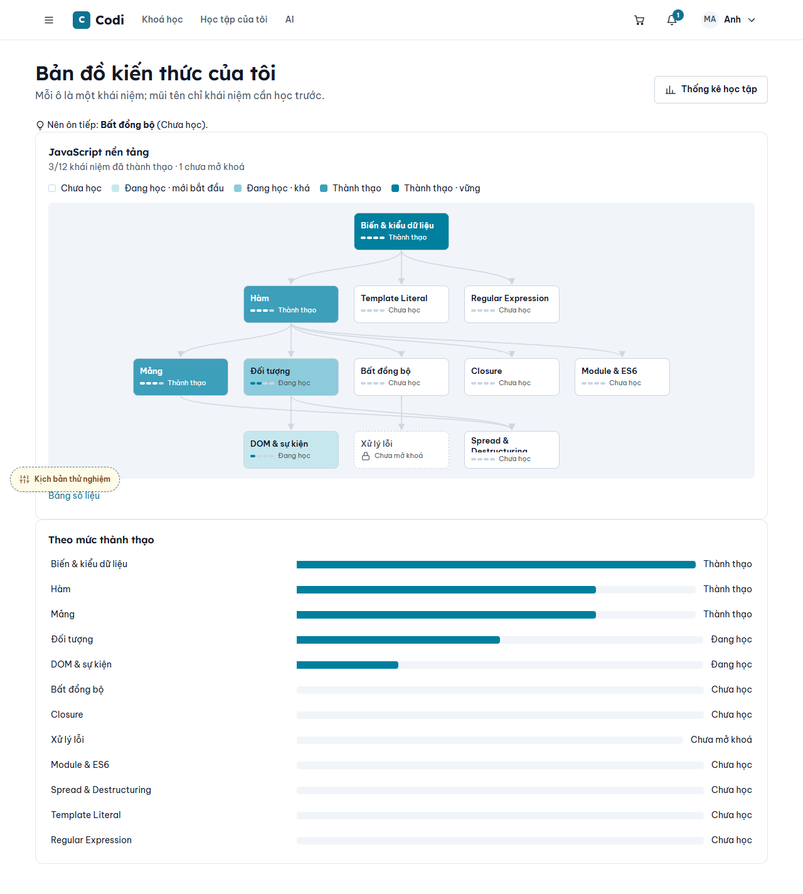
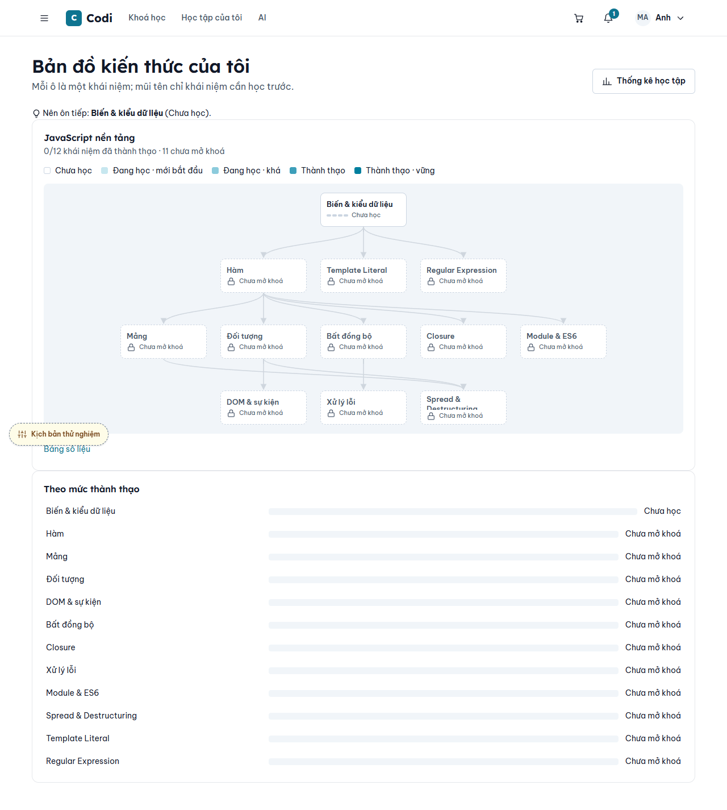

# Issue #161 — Knowledge map mockup parity

Epic #94 · S13c · Flow L12 · `/insights/knowledge-map`.

## Implementation

- Geometry matches `docs/mockup/js/charts.js`: nodes 152×60, horizontal gap 24, vertical gap 56, padding 16. Each topological layer is centred; edges run from the prerequisite's bottom centre to the next node's top centre.
- Uses the existing `viz-s1…s4`, `viz-axis`, `viz-on-s4`, surface and border tokens in both themes. Locked nodes retain dashed borders and a lock label; mastery has text and a four-step meter.
- Restores the page header, “Nên ôn tiếp”, legend, “Bảng số liệu” disclosure and sorted “Theo mức thành thạo” chart. The course selector appears only for multiple enrolled courses, as in the mock.
- Selection still highlights ancestors and opens related lessons. Recommendation markers, confirmed-map visibility, ownership and lesson prerequisite checks retain the server contract. No schema/API changes.
- The user explicitly chose to keep **Thống kê học tập** visible but disabled until the statistics module supplies `/insights/stats`; there is no link to a nonexistent route. This dependency must be resolved when that module is integrated.
- PR #160 / issue #156 supplies the explicit lesson CTA separately. This branch starts from develop and leaves `ConceptDetails` lesson rendering untouched so that change can merge independently. Full UI-LRN-25 validation depends on integrating #160.

## Mapping

| Contract | Implementation | Verification |
|---|---|---|
| Read-only layered graph, mastery labels | `KnowledgeMap`, `KnowledgeMapNode`, `knowledgeGraphLayout`, `KnowledgeGraphLines` | Layout and component tests; desktop light geometry/background/radius compared with all 12 prototype nodes |
| Selection and prerequisite path | Existing ancestor traversal and `ConceptDetails` | Component tests and browser selection assertions |
| Locked lesson cannot navigate | Existing API/service lock fields and panel rendering | Existing guard tests; component and browser no-link assertions |
| Diagnostic skipped / no evidence | Level zero, empty meter, no fabricated probability | Component tests and desktop light screenshot |
| Empty / unconfirmed | `EmptyKnowledgeMap` | Existing tests, course-switch test, browser assertions |
| Loading / HTTP failure / retry | Existing fetch lifecycle, visible retry | Component test and browser assertions |
| Multiple courses | Selector, abort previous request, clear selection | Component course-switch test |

## Validation and remaining work

- Full Vitest run: **72 files, 937 tests passed**, with `--coverage --maxWorkers=4`; configured coverage gate passed (98.95% statements, 85.16% branches, 96.96% functions, 98.84% lines). The configured coverage include list is shared infrastructure, not a claim of 98.95% graph coverage.
- Design standards: **0 violations**.
- Package type checks passed after regenerating stale Next route types left by the branch switch.
- Desktop light browser assertions passed for the 12-node geometry/colours/radii, selection, ancestor highlighting, lock guards, table disclosure, unlearned state, empty/unconfirmed state and error retry. Loading was observed; the scratch suite then failed because its response-release callback had not yet been installed. The script was corrected to await the callback, but the subsequent Chrome launch was denied permission. **The complete browser matrix is not marked passed.**
- **Still required before merge:** rerun the corrected browser suite on desktop 1280px and mobile 375px, in light and dark; refresh screenshots after the final chart-label/shadow/spacing polish. Current images show the earlier desktop light pass. Element screenshots include the shared sticky header, which can obscure the page heading; replace them with full-page captures.
- Browser fixtures use the prototype's JavaScript course data and mocked API/session responses, not authenticated production accounts. No seeded authenticated end-to-end run is claimed.

## Follow-up review on 2026-10-20

- User requested a separate real development dataset matching the left-hand mockup, rather than changing the existing three-concept TypeScript course.
- Added `scripts/seed-knowledge-map-dev.ts` and `pnpm --filter web db:seed-knowledge-map -- --user-id=<learner-id>`. The account is explicit; no password is needed. It creates a hidden course `dev-knowledge-map-161` titled “JavaScript nền tảng”, using concepts, prerequisites and mastery from the existing mockup export. Existing courses and progress are untouched; reruns preserve the fixture enrollment's learner activity.
- Seeded only the learner account selected by the user. Verified through `createLearningPathService.getKnowledgeMap`: confirmed, 12 concepts, 12 edges, layers 1–3–5–3, 3 mastered, only “Xử lý lỗi” locked, next concept “Bất đồng bộ”. Every concept has a real related lesson.
- Web TypeScript check passed after the seed script was added.
- Refreshed full-page desktop light/dark screenshots. Both desktop browser runs passed node geometry/colour comparisons and selection, lock, table, empty, unconfirmed, retry and loading checks. These replace the earlier desktop-only evidence described above.
- The mobile light run found document-level horizontal overflow at the initial map capture. Mobile verification is **not passed**; investigate before PR. Dark mobile has not run.
- User requested to inspect before any PR. Work paused for that review; no push or PR. Temporary browser fixture route removed.

Review URL: `http://localhost:3001/insights/knowledge-map?course=dev-knowledge-map-161`.

## Testable course follow-up

- On the user's request, expanded the same separate course into a usable simulation: 12 published reading lessons and 6 published quizzes copied from the existing JavaScript mockup export. Related reading content comes from `js-course-content.json` where available. Quiz answers use the snapshot's `correctIndex`; no assessment submissions are fabricated.
- Initializes an untouched fixture enrollment with a ready default path. Existing goals, path choices, mastery and activity are preserved on reruns. No AI provider calls are needed.
- Real service verification passed: course path ready/default, 12 lesson rows, 6 quiz rows, a current lesson with access allowed; the map remains confirmed with 12 nodes, 12 edges and layers 1–3–5–3.
- Added a learner dashboard shortcut: **Học tập của tôi → Chức năng & Lối tắt → Bản đồ kiến thức**. Select “JavaScript nền tảng” to view this fixture. Direct course entry: `http://localhost:3001/learn/dev-knowledge-map-161`, then **Bản đồ kiến thức** beside **Lộ trình học**.
- This follow-up does not resolve the previously recorded mobile overflow. No push or PR has been made; the user is still reviewing.

## Catalog entry requested for manual testing

- The user clarified that the simulation must appear on the **Khoá học** catalog itself. Ran the development seed with `--catalog`, publishing only `dev-knowledge-map-161` with the distinct title **JavaScript nền tảng — Mô phỏng bản đồ kiến thức**. The existing selected learner enrollment and activity remain unchanged.
- Verified the real `/api/courses` response includes this ID with `status: published` and price 0. The existing catalog card's owned-course action routes to `/learn/dev-knowledge-map-161`; from there choose **Bản đồ kiến thức**. Search for “Mô phỏng bản đồ kiến thức” on `/courses` to locate it.
- No catalog API filters or publication rules for other courses were changed. `--catalog` is an explicit development-seed option; ordinary reruns do not change visibility.
- Temporary fixture route was removed. No `.env`, credentials, fake data or scenario flags are shipped in application code. `docs/mockup/**` is unchanged.
- Images are stored in this repository as review evidence. Direct GitHub drag-and-drop uploads are unavailable in this environment.

## Screenshot evidence (desktop light, pending final refresh)

| State | Mockup | Implementation |
|---|---|---|
| Confirmed map |  |  |
| All unlearned |  |  |
| Selected, unlocked | Standalone prototype has no interactive panel; Flow L12 defines it |  |
| Selected, locked | Same limitation |  |
| Table expanded | Data-equivalent table under the graph |  |
| Unconfirmed | Backend condition absent from standalone prototype |  |
| No enrolments | Empty state |  |
| HTTP error | Network condition absent from static prototype |  |
| Loading | Network condition absent from static prototype |  |
