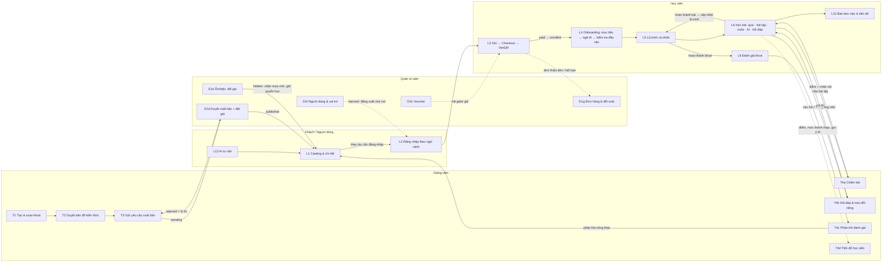

# Codi — Luồng người dùng end-to-end theo vai trò

Tài liệu này là **bản đồ điều hướng** cho mọi luồng nghiệp vụ của Codi: ai làm gì, theo thứ tự nào, chạm vào
trạng thái nào, ở màn hình/route nào, và luồng đó đã có trên `develop` hay chưa. Nó **không** thay thế nguồn sự
thật — khi có khác biệt, các file dưới đây thắng:

| Nguồn (ràng buộc) | Chứa gì |
|---|---|
| [`mockup/README.md`](mockup/README.md) | Cái gì ràng buộc / cái gì tự do, module map mockup → route thật |
| [`mockup/PRODUCT.md`](mockup/PRODUCT.md) | Hành trình (§4), đặc tả luồng L\*/A\*/T\*/D\* (§5), màn hình & state (§6), quy tắc tương tác (§7) |
| [`mockup/STATE-MACHINES.md`](mockup/STATE-MACHINES.md) | Enum, chuyển trạng thái, guard, side effect — **không được đổi** trong PR tính năng |
| [`mockup/product-updated-12-10.md`](mockup/product-updated-12-10.md) | Lý do của các quyết định 12/10 và 14/10 (D1–D18) |

Cách đọc:

- **ID luồng** giữ nguyên của `PRODUCT.md` §5. Luồng lớn (L3, T1, T4, D1) được tách thành luồng con `L3a`, `T4b`, `D1f`…
  ID có tiền tố `U-` là luồng chung suy ra từ màn hình §6 (không có ID riêng trong PRODUCT).
- **Trạng thái** trỏ tới mục tương ứng trong `STATE-MACHINES.md`; enum viết đúng như source (`pending`, `in_review`…).
- **Màn hình** dùng mã S\*\* của PRODUCT §6; "state bắt buộc" là các state phải tồn tại theo §6.
- Các thành phần mà [STATE-MACHINES §23](mockup/STATE-MACHINES.md#23-prototype-only--do-not-implement) đánh dấu
  prototype-only (drawer kịch bản, `localStorage`, seed, độ trễ giả, mô phỏng Python, email `hotro@codi.vn`) **không** có
  trong tài liệu này.

> **Trạng thái triển khai là ảnh chụp có phạm vi**: kiểm tra trên `develop` tại commit `3124d82` (merge PR #132 —
> giỏ hàng/voucher/checkout), đối chiếu `apps/web/src/app/**/page.tsx` và `apps/web/src/app/api/**/route.ts`.
> PR đang mở (chưa merge, xếp chồng lên nhau): #129 → #130 → #131 → #133 → #134. Khi một PR merge hoặc một luồng
> thay đổi, cập nhật nhãn của luồng đó và bảng [Tổng quan](#3-tổng-quan-trạng-thái-triển-khai).
>
> Nhãn: **Implemented** = luồng chính chạy end-to-end và các state bắt buộc chủ yếu đã có · **Partial** = có route/API
> nhưng thiếu bước hoặc state bắt buộc (liệt kê ở mục "Khoảng trống") · **Missing** = chưa có route/API · **In open PR #N**
> = route chỉ có trong PR chưa merge.

---

## 1. Vai trò và ma trận quyền

Vai trò lưu trong bảng `user_roles` (có `revokedAt`); một người có thể có nhiều vai trò đang hoạt động. Trạng thái tài
khoản dùng cờ `banned` của Better Auth — tương ứng `inactive` trong
[STATE-MACHINES §21](mockup/STATE-MACHINES.md#21-user-account) (`active` ⇔ `banned = false`).

### 1.1 Ma trận năng lực

| Năng lực | Khách | Học viên (`learner`) | Giảng viên (`lecturer`) | Quản trị viên (`admin`) |
|---|---|---|---|---|
| Xem catalog, chi tiết khoá, đánh giá | ✓ | ✓ | ✓ (CTA "Bạn đang xem với vai trò …") | ✓ (như giảng viên) |
| Dùng AI tư vấn `/ai` | ✓ (không cá nhân hoá) | ✓ (cá nhân hoá — mục tiêu) | ✓ | ✓ |
| Thêm giỏ, Mua ngay, đăng ký miễn phí, áp voucher, thanh toán | → mở đăng nhập (G15) | ✓ | ✗ (G14) | ✗ (G14) |
| Onboarding, lộ trình, học bài, quiz, bài tập, code, đánh giá khoá | ✗ | ✓ (khoá đã sở hữu) | ✗ | ✗ |
| Hỏi đáp / trao đổi riêng với giảng viên | ✗ | ✓ gửi | ✓ trả lời, giải quyết/mở lại | ✓ giải quyết/mở lại (D9) |
| Tạo/soạn khoá, bản đồ kiến thức, gửi xuất bản | ✗ | ✗ | ✓ khoá của mình | ✗ |
| Chấm bài, trả lời đánh giá, xem tiến độ & doanh thu khoá của mình | ✗ | ✗ | ✓ | ✗ |
| Duyệt xuất bản, đặt giá, ẩn/hiện khoá | ✗ | ✗ | ✗ | ✓ |
| Quản lý người dùng, đơn hàng, voucher, phân tích hệ thống/tài chính | ✗ | ✗ | ✗ | ✓ |
| Cài đặt tài khoản, hồ sơ, thông báo | ✗ | ✓ | ✓ | ✓ |

Nguồn quy tắc: [STATE-MACHINES §1](mockup/STATE-MACHINES.md#1-global-invariants) (G14 chỉ học viên mua; G15 hành động
bị chặn sẽ tiếp tục sau đăng nhập; D9 quyền giải quyết hội thoại), [§2](mockup/STATE-MACHINES.md#2-course-ownership-derived-state)
(CTA theo vai trò).

### 1.2 Guard và chuyển hướng hiện có

| Phạm vi | Guard | Khi không đạt | Chủ sở hữu |
|---|---|---|---|
| `/dashboard/**` | cookie phiên | → `/login` | [`proxy.ts`](../apps/web/src/proxy.ts) |
| `/dashboard` | vai trò đang hoạt động, ưu tiên `admin` > `lecturer` > `learner` | admin → `/dashboard/admin`; lecturer → `/dashboard/lecturer`; không có vai trò → `/login` | [`dashboard/page.tsx`](../apps/web/src/app/dashboard/page.tsx) |
| `/dashboard/admin/**` | vai trò `admin` | → `/dashboard` | [`dashboard/admin/page.tsx`](../apps/web/src/app/dashboard/admin/page.tsx) |
| `/dashboard/lecturer` | vai trò `lecturer` | → `/dashboard` | [`dashboard/lecturer/page.tsx`](../apps/web/src/app/dashboard/lecturer/page.tsx) |
| `/learn/**`, `/insights/knowledge-map` | phiên + vai trò `learner` | chưa đăng nhập → `/login?callbackURL=<trang>`; sai vai trò → thông báo "Bạn không có quyền học viên đang hoạt động." | [`learner-page-guard.tsx`](../apps/web/src/components/learner-page-guard.tsx), [`learn/[courseId]/[lessonId]/layout.tsx`](../apps/web/src/app/learn/[courseId]/[lessonId]/layout.tsx) |
| Bài học bị khoá / chưa có lộ trình | `learningPathService.assertLessonAccess` | màn "Bài học này đang bị khoá" + link bài tiên quyết; chưa có lộ trình → "Thiết lập lộ trình trước khi học" | [`learn/[courseId]/[lessonId]/layout.tsx`](../apps/web/src/app/learn/[courseId]/[lessonId]/layout.tsx) |
| `/settings`, `/profile` | phiên | → `/login` | các `page.tsx` tương ứng |
| `/cart`, `/checkout`, `/courses/[slug]/checkout` | phiên | → `/login?returnTo=` / `?next=` rồi quay lại | [`cart-view.tsx`](../apps/web/src/components/cart/cart-view.tsx), [`checkout/page.tsx`](../apps/web/src/app/checkout/page.tsx) |
| API thương mại (`/api/student/cart`, `/api/orders/*`, `/api/vouchers/validate`, `/api/courses/enroll-free`) | `requireRole(…, ROLE.LEARNER)` | 401 chưa đăng nhập, 403 sai vai trò | các `route.ts` tương ứng |
| Đăng nhập khi `banned` | hook `session.create.before` | từ chối tạo phiên; khoá tài khoản xoá mọi phiên hiện có | [`packages/auth/src/index.ts`](../packages/auth/src/index.ts), [`dashboard/admin/actions.ts`](../apps/web/src/app/dashboard/admin/actions.ts) |
| Điều hướng header | theo vai trò: Học viên "Khoá học · Học tập của tôi · AI" + giỏ hàng; Giảng viên "Giảng dạy · Khoá học"; Admin "Quản trị · Khoá học" | — | [`header.tsx`](../apps/web/src/components/header.tsx), `getRoleHome` trong [`packages/auth/src/roles.ts`](../packages/auth/src/roles.ts) |

Tham số quay lại sau đăng nhập (`returnTo` / `callbackURL` / `next`) được làm sạch bởi
[`safe-redirect.ts`](../apps/web/src/lib/safe-redirect.ts) trước khi dùng.

---

## 2. Sơ đồ liên kết giữa các vai trò

---

## 3. Tổng quan trạng thái triển khai

| Vai trò | Implemented | Partial | Missing | In open PR |
|---|---|---|---|---|
| Khách / Người dùng | [L1](#l1--khám-phá--đánh-giá-khoá-học), [L2](#l2--hành-động-cần-đăng-nhập-cho-khách) | [A1](#a1--đăng-ký--xác-thực-email), [A2](#a2--khôi-phục-mật-khẩu), [A3](#a3--cài-đặt-tài-khoản), [U-PROFILE](#u-profile--hồ-sơ-cá-nhân), [U-NOTIF](#u-notif--thông-báo-trong-ứng-dụng), [L13](#l13--ai-tư-vấn-khoá-học-ai) | — | — |
| Học viên | [L3a](#l3a--thêm-vào-giỏ--quản-lý-giỏ), [L3b](#l3b--áp-dụng-voucher), [L3c](#l3c--mua-ngay), [L4](#l4--onboarding-mục-tiêu--ngã-rẽ--kiểm-tra-đầu-vào), [L5](#l5--lộ-trình-học-cá-nhân), [L6b](#l6b--bài-tập-code), [L7](#l7--quiz), [L12](#l12--bản-đồ-kiến-thức-của-tôi) | [L3d](#l3d--checkout-vietqr--xác-nhận-thanh-toán), [L3e](#l3e--đăng-ký-khoá-miễn-phí), [L6](#l6--học-một-bài), [L8](#l8--bài-tập-nộp-file--link), [L9](#l9--đánh-giá-khoá-học), [L10](#l10--bàn-làm-việc-và-tiến-độ--kết-quả) | [L6c](#l6c--ai-trợ-lý-trong-bài-học), [L6d](#l6d--hỏi-đáp-công-khai-và-trao-đổi-riêng-với-giảng-viên), [L11](#l11--thống-kê-học-tập), [L14](#l14--hồ-sơ-năng-lực-từ-github) | — |
| Giảng viên | — | — | [T4a](#t4a--chấm-bài-tập), [T4b](#t4b--hộp-thư-hỏi-đáp-và-trao-đổi-riêng), [T4c](#t4c--phản-hồi-đánh-giá), [T4d](#t4d--tiến-độ-học-viên), [T4e](#t4e--doanh-thu-khoá-học-của-tôi) | #129: [T0](#t0--trang-chủ-giảng-viên), [T1a](#t1a--tạo-khoá-học-tối-giản) · #130: [T1b](#t1b--trình-soạn-khoá-thông-tin--nội-dung), [T1c](#t1c--trình-tạo-quiz-và-bài-kiểm-tra-đầu-vào) · #131: [T1d](#t1d--trình-tạo-bài-tập-code) · #129/#130/#131: [T1e](#t1e--bản-nháp-do-ai-tạo) · #133: [T2](#t2--duyệt-bản-đồ-kiến-thức-ai) · #134: [T3](#t3--yêu-cầu-xuất-bản) |
| Quản trị viên | — | [D1a](#d1a--bảng-điều-khiển-quản-trị), [D1f](#d1f--người-dùng) | [D1b](#d1b--quan-sát-hệ-thống), [D1c](#d1c--tài-chính), [D1e](#d1e--khoá-học-đã-xuất-bản-ẩnhiện-đổi-giá), [D1g](#d1g--đơn-hàng--giao-dịch-xuất-csv), [D1h](#d1h--voucher) | #134: [D1d](#d1d--duyệt-xuất-bản--xem-trước-như-học-viên) |

---

## 4. Khách và người dùng đã đăng ký (chung mọi vai trò)

### L1 — Khám phá & đánh giá khoá học

- **Tác nhân:** Khách, mọi người dùng.
- **Tiền điều kiện:** khoá ở trạng thái `published`.
- **Bước chính:** 1) `/courses`: tìm kiếm có typeahead nhóm theo loại, lọc danh mục/trình độ/giá, chip lọc gỡ được +
  "Xóa bộ lọc", dropdown "Sắp xếp". 2) Mở thẻ → `/courses/[slug]`: hero, chuẩn đầu ra, đề cương có icon + nhãn loại bài
  và badge "Học thử", yêu cầu, giảng viên, đánh giá. 3) Thẻ mua dính theo trạng thái sở hữu.
- **Nhánh:** CTA theo `ownership` — `not-owned` → "Mua ngay" (chính) + "Thêm vào giỏ"; `in-cart` → "Đã trong giỏ hàng" +
  "Xem giỏ hàng"; `pending-payment` → "Tiếp tục thanh toán"; `owned` → tiến độ + "Tiếp tục học"; `free` → "Đăng ký miễn
  phí"; giảng viên/admin → "Bạn đang xem với vai trò …". Khoá không còn `published` và chưa ghi danh → "Khoá học tạm ngừng
  bán"; `hidden` nhưng đã ghi danh → vẫn học. Không có kết quả → giữ chip + "Đặt lại bộ lọc" + "Hỏi AI Codi".
- **Trạng thái:** [§2 Ownership](mockup/STATE-MACHINES.md#2-course-ownership-derived-state) (thứ tự đánh giá
  `owned → pending-payment → in-cart → free → not-owned`).
- **Màn hình:** S01 (loading, results, typeahead open/none, no results, error, filtered, sorted); S02 (guest, not owned,
  in cart, owned, free, hidden/unavailable, loading, error, empty curriculum, just-added).
- **Route:** `/courses`, `/courses/[slug]` · API `/api/courses`, `/api/courses/[slug]`, `/api/courses/ownership`.
- **Triển khai:** **Implemented.** Chi tiết: [`course-details.md`](course-details.md). Khác biệt nhỏ: nhãn sắp xếp
  (`popular`, `newest`, `price-asc`, `price-desc`, `rating`) khác bộ "Phù hợp nhất / Mới nhất / Đánh giá cao nhất / Học
  nhiều nhất" của PRODUCT; trình phát bài "Học thử" vẫn là câu hỏi mở Q23.

### L2 — Hành động cần đăng nhập cho khách

- **Tác nhân:** Khách.
- **Tiền điều kiện:** khách bấm "Thêm vào giỏ", "Mua ngay" hoặc "Đăng ký miễn phí".
- **Bước chính:** 1) Mở modal đăng nhập ngay trên trang khoá (S03), nêu rõ ý định. 2) Đăng nhập (email/mật khẩu, Google,
  GitHub) hoặc đăng ký + OTP ngay trong modal. 3) Modal đóng **trên cùng trang**, hành động tự hoàn tất: toast "Đã thêm …
  vào giỏ hàng" + "Xem giỏ hàng", badge giỏ tăng, CTA đổi trạng thái; "Mua ngay" đi thẳng tới checkout.
- **Nhánh:** không bao giờ đưa về `/dashboard` hoặc trang chủ; sai mật khẩu → lỗi inline; tài khoản bị khoá → thông báo
  riêng (không chung chung); vai trò không phải học viên → "Chỉ tài khoản học viên mới …".
- **Trạng thái:** G15 trong [§1](mockup/STATE-MACHINES.md#1-global-invariants); D12 trong
  [§21](mockup/STATE-MACHINES.md#21-user-account).
- **Màn hình:** S03 (default, error, deactivated account, loading); S02 just-added.
- **Route:** modal [`auth-modal.tsx`](../apps/web/src/components/auth/auth-modal.tsx) trên `/courses/[slug]`; trang dự
  phòng `/login?returnTo=…` · API `/api/auth/[...all]`.
- **Triển khai:** **Implemented.** Ý định được giữ qua `sessionStorage` và chạy lại sau đăng nhập
  ([`course-detail-view.tsx`](../apps/web/src/components/courses/course-detail-view.tsx)). Khoảng trống: thông điệp khi
  tài khoản bị khoá là chuỗi không dấu "Tai khoan da bi khoa." từ hook auth.

### A1 — Đăng ký & xác thực email

- **Tác nhân:** Khách.
- **Bước chính:** form đăng ký → màn "Nhập mã xác thực" 6 ô, hiện email đích kèm "Sửa", "Gửi lại mã" có đếm ngược →
  xác thực xong → đã đăng nhập, quay về ý định ban đầu.
- **Nhánh:** mã sai → lỗi dưới ô, giữ giá trị; mã hết hạn → mời gửi lại; quá số lần → thông báo chờ.
- **Màn hình:** S04 (OTP wrong / expired / resend countdown).
- **Route:** `/login?tab=signup` · Better Auth email OTP qua `/api/auth/[...all]`.
- **Triển khai:** **Partial.** Có OTP 6 số, đếm ngược và "Gửi lại mã" ([`otp-input.tsx`](../apps/web/src/components/otp-input.tsx),
  [`sign-up-form.tsx`](../apps/web/src/components/sign-up-form.tsx)). Thiếu link "Sửa" email trên màn OTP.

### A2 — Khôi phục mật khẩu

- **Tác nhân:** Người dùng chưa đăng nhập.
- **Bước chính:** "Quên mật khẩu?" → nhập email → xác nhận **trung lập** (không tiết lộ tài khoản có tồn tại), nhắc kiểm
  tra thư rác + gửi lại → đặt mật khẩu mới → thành công với một CTA "Đăng nhập".
- **Màn hình:** S04 (check email trung lập, reset, success).
- **Route:** `/forgot-password`, `/reset-password`.
- **Triển khai:** **Partial.** Luồng chạy bằng mã OTP qua email ([`forgot-password/page.tsx`](../apps/web/src/app/forgot-password/page.tsx)).
  Khoảng trống: lỗi từ API được hiển thị nguyên văn (chưa đảm bảo trung lập), chưa có gợi ý thư rác, sau thành công tự
  chuyển về đăng nhập thay vì chờ người dùng bấm (§7.5).

### A3 — Cài đặt tài khoản

- **Tác nhân:** Mọi người dùng đã đăng nhập.
- **Bước chính:** điều hướng trái theo mục "Thông tin tài khoản", "Mật khẩu & Bảo mật"; sửa tại chỗ, Lưu/Huỷ chỉ hiện khi
  có thay đổi; đổi email phải xác thực OTP địa chỉ mới; "Đăng xuất" truy cập được. Mục mới "Tài khoản liên kết" (một
  dòng GitHub — xem L14); nếu GitHub là cách đăng nhập duy nhất thì "Ngắt kết nối GitHub" bị khoá kèm hướng dẫn đặt mật khẩu.
- **Màn hình:** S04b.
- **Route:** `/settings` · API `/api/user/profile`, `/api/auth/[...all]`.
- **Triển khai:** **Partial.** Có hai mục, đổi tên/email/mật khẩu, quản lý phiên
  ([`components/settings/`](../apps/web/src/components/settings/)). Thiếu "Tài khoản liên kết".

### U-PROFILE — Hồ sơ cá nhân

- **Tác nhân:** Mọi người dùng đã đăng nhập (tab học tập dành cho học viên).
- **Bước chính:** xem/sửa tên, ảnh đại diện, xác thực email; tab "Khóa học" **dẫn vào khoá** (không còn ngõ cụt, PRODUCT
  L10); tab "Giao dịch" là nơi tìm lại đơn đang chờ (§7.3); tab "Hồ sơ năng lực" (S04c, L14).
- **Màn hình:** S04b, S04c.
- **Route:** `/profile` · API `/api/user/profile`, `/api/user/avatar`, `/api/avatar`, `/api/student/profile`, `/api/user/roles`.
- **Triển khai:** **Partial.** Có các tab "Khóa học" và "Giao dịch"
  ([`student-profile-overview.tsx`](../apps/web/src/components/profile/student-profile-overview.tsx)) nhưng dòng khoá học
  chưa có liên kết; chưa có tab "Hồ sơ năng lực".

### U-NOTIF — Thông báo trong ứng dụng

- **Tác nhân:** Mọi người dùng đã đăng nhập.
- **Bước chính:** chuông trên header hiện số chưa đọc → mở danh sách → bấm một thông báo (đánh dấu đã đọc, đi tới
  `link` nội bộ) hoặc "đọc tất cả".
- **Sự kiện phải phát** (chỉ trong ứng dụng, D15): thanh toán thành công, đơn hết hạn, thanh toán muộn được chấp nhận,
  lộ trình cập nhật, câu hỏi được trả lời, trả lời trao đổi riêng, câu hỏi riêng tới giảng viên, bài được chấm / sửa điểm,
  yêu cầu xuất bản mới, duyệt / yêu cầu sửa / từ chối / ẩn / hiện lại / đổi giá khoá, bản đồ kiến thức sẵn sàng, hồ sơ
  năng lực sẵn sàng / thất bại. Danh sách tiêu đề nguyên văn: [§22](mockup/STATE-MACHINES.md#22-notifications).
- **Màn hình:** S40, S41.
- **Route:** chuông [`notification-menu.tsx`](../apps/web/src/components/notification-menu.tsx) · API `/api/notifications`.
- **Triển khai:** **Partial.** Hạ tầng đọc/đánh dấu đã có ([`notification-service.ts`](../apps/web/src/lib/notification-service.ts));
  hiện chỉ sự kiện hoàn thành bài ("Lộ trình đã được cập nhật") phát thông báo. Thanh toán thành công chưa phát.

### L13 — AI tư vấn khoá học `/ai`

- **Tác nhân:** Khách (chung chung), Học viên (cá nhân hoá theo khoá đang học, tiến độ, hồ sơ).
- **Bước chính:** 1) Trang đầu: lời chào + dòng ngữ cảnh, 3 thẻ nhiệm vụ "Tìm khoá học cho mục tiêu · So sánh khoá học ·
  Lên lộ trình học", 2–3 câu gợi ý cá nhân; khách thấy "Đăng nhập để Codi gợi ý theo tiến độ của bạn". 2) Hỏi lần lượt
  mục tiêu/trình độ/giờ mỗi tuần bằng chip (lưu vào hồ sơ, onboarding L4 dùng lại). 3) Trả lời có cấu trúc: thẻ khoá học
  với CTA theo sở hữu, bảng so sánh 2–3 khoá, thứ tự học gợi ý (không lưu lộ trình nhiều khoá — quyết định 54).
- **Nhánh:** không có khoá phù hợp → "Codi chưa có khoá cho mục tiêu này" + phương án gần nhất; bị giới hạn tần suất (429);
  lỗi; "Dừng" khi đang nghĩ.
- **Màn hình:** S17 (guest, signed-in, intake, answering, no match, rate-limited, error).
- **Route:** `/ai` · API `/api/ai` (stream, giới hạn theo IP, prompt chứa catalog).
- **Triển khai:** **Partial.** Có chat stream mở cho khách ([`ai/page.tsx`](../apps/web/src/app/ai/page.tsx),
  [`api/ai/route.ts`](../apps/web/src/app/api/ai/route.ts)). Thiếu thẻ nhiệm vụ, intake chip, thẻ khoá học/bảng so sánh,
  cá nhân hoá, lịch sử hội thoại, phản hồi 👍/👎.

---

## 5. Học viên

### L3a — Thêm vào giỏ & quản lý giỏ

- **Tác nhân:** Học viên.
- **Tiền điều kiện:** khoá `not-owned` và không nằm trong đơn `pending`.
- **Bước chính:** "Thêm vào giỏ" → CTA đổi "Đã trong giỏ hàng" + toast → `/cart`: dòng hàng (ảnh, tên, giảng viên, giá,
  ×), ô "Mã giảm giá", tóm tắt (tạm tính, giảm giá, tổng) → "Thanh toán" tạo đơn từ giỏ (giỏ được làm trống).
- **Nhánh:** xoá dòng → xoá ngay + toast "Hoàn tác" (G1, không hỏi xác nhận); khoá đã sở hữu trong giỏ → tự loại kèm giải
  thích; đã có đơn `pending` → banner "Bạn có đơn hàng … đang chờ thanh toán" và khi bấm "Thanh toán" thì chọn "Tiếp tục
  đơn cũ" / "Huỷ đơn cũ, tạo đơn mới" (đơn cũ → `cancelled`).
- **Trạng thái:** [§3 Cart](mockup/STATE-MACHINES.md#3-cart); tạo đơn: [§5.2](mockup/STATE-MACHINES.md#52-order-state-machine).
- **Màn hình:** S05 (empty, items, voucher applied/invalid, item already owned, pending order exists).
- **Route:** `/cart` · API `/api/student/cart`, `/api/orders/checkout`.
- **Triển khai:** **Implemented** ([`cart-view.tsx`](../apps/web/src/components/cart/cart-view.tsx),
  [`checkout-cart.ts`](../apps/web/src/lib/checkout-cart.ts)).

### L3b — Áp dụng voucher

- **Tác nhân:** Học viên.
- **Bước chính:** nhập mã → "Áp dụng" → kiểm tra theo thứ tự: tồn tại → đang bật → còn hạn → còn lượt → đạt đơn tối thiểu
  (lỗi đầu tiên thắng, chuỗi lỗi nguyên văn ở §4) → giảm `percent` hoặc `amount`, tổng = `max(0, tạm tính − giảm)`.
- **Nhánh:** giỏ thay đổi làm mất điều kiện → voucher thành không hợp lệ, giảm 0; gỡ mã. Một voucher mỗi đơn, áp cả giỏ,
  không cộng dồn (D14); đơn "Mua ngay" không nhận voucher. `used += 1` chỉ khi đơn `paid`.
- **Trạng thái:** [§4 Voucher](mockup/STATE-MACHINES.md#4-voucher-apply--validation).
- **Màn hình:** S05 (voucher applied, voucher invalid).
- **Route:** trong `/cart` · API `/api/vouchers/validate`; tăng lượt dùng trong `/api/payments/sepay/callback`.
- **Triển khai:** **Implemented** ([`cart-service.ts`](../apps/web/src/lib/cart-service.ts)). Phía quản trị voucher: D1h.

### L3c — Mua ngay

- **Tác nhân:** Học viên (khách đi qua L2 trước).
- **Bước chính:** "Mua ngay" trên S02 → tạo đơn **một khoá**, `voucherCode` rỗng, giỏ và voucher của giỏ giữ nguyên →
  mở checkout của đơn đó.
- **Nhánh:** khoá đã có đơn `pending` → mở lại đơn đó thay vì tạo mới; đã sở hữu (409) → CTA chuyển "Tiếp tục học".
- **Trạng thái:** D4 trong [§2](mockup/STATE-MACHINES.md#2-course-ownership-derived-state), [§5.2](mockup/STATE-MACHINES.md#52-order-state-machine).
- **Route:** `/courses/[slug]` → `/courses/[slug]/checkout?order=<code>` · API `/api/orders/buy-now`.
- **Triển khai:** **Implemented** ([`buy-now.ts`](../apps/web/src/lib/buy-now.ts)).

### L3d — Checkout VietQR & xác nhận thanh toán

- **Tác nhân:** Học viên; hệ thống (webhook ngân hàng, bộ đếm hết hạn).
- **Tiền điều kiện:** có đơn `pending` (từ L3a hoặc L3c).
- **Bước chính:** 1) Tóm tắt đơn (mọi khoá, voucher), phương thức chuyển khoản. 2) Chờ thanh toán: VietQR, **đếm ngược
  ngay dưới QR** (30 phút) + nêu hậu quả khi hết hạn; các dòng sao chép Ngân hàng / Số tài khoản / Chủ tài khoản / Số tiền /
  Nội dung chuyển khoản (= `CODI#####`, nhấn mạnh) — đồng thời là phương án dự phòng khi QR lỗi; tracker 3 bước *Đã tạo đơn →
  Đang chờ thanh toán → Đã nhận tiền*; dòng trạng thái đang kiểm tra. 3) "Tôi đã chuyển khoản" → kiểm tra thêm một lần, kết
  quả **inline** dưới nút, khoá 30 giây, tự kiểm tra vẫn chạy (D5, G11). 4) Webhook xác nhận đủ tiền → `paid` → ghi danh
  từng khoá, voucher `used += 1`, thông báo người mua. 5) Màn thành công "Thanh toán thành công!" liệt kê khoá, CTA chính
  "Bắt đầu học" → L4, phụ "Về bàn làm việc"; **không tự chuyển trang** (G3).
- **Nhánh:** hết 30 phút → `failed` + `failReason='expired'`, "Mã thanh toán đã hết hạn" + "Tạo mã mới" (đơn mới, giữ dòng
  cũ) + "Về giỏ hàng"; thiếu tiền → vẫn `pending`, "Đã nhận X / cần Y", chuyển thêm cùng nội dung; thừa tiền → `paid` + gắn cờ
  đối soát; sai nội dung → hỗ trợ thủ công; chuyển đủ sau khi hết hạn → `failed → paid` trừ khi đã sở hữu mọi khoá (D2);
  huỷ → hộp xác nhận → `cancelled`, khoá quay lại giỏ, về `/cart`; rời trang → đơn vẫn chờ, tìm lại ở giỏ / "Giao dịch".
  Mọi state có vấn đề hiển thị `CODI#####` + lối hỗ trợ (G10). `refunded` để dành, không có luồng hoàn tiền (D18).
- **Trạng thái:** [§5 Order + payment](mockup/STATE-MACHINES.md#5-order--payment-vietqr-bank-transfer) (enum `pending` |
  `paid` | `failed` | `cancelled` | `refunded`; UI states [§5.3](mockup/STATE-MACHINES.md#53-checkout-ui-states-checkoutorder));
  [§6 Enrolment](mockup/STATE-MACHINES.md#6-enrolment).
- **Màn hình:** S06 (creating, awaiting, QR failed, manual check in progress, still pending, confirmed, expired, underpaid,
  cancelled, error creating order, payments unavailable); S07.
- **Route:** `/checkout?order=<code>` chuyển hướng tới `/courses/[slug]/checkout?order=<code>` · API
  `/api/payments/create-transaction`, `/api/payments/check-transaction/[id]`, `/api/payments/sepay/callback`, `/api/orders/cancel`.
- **Triển khai:** **Partial.** Đã có: QR + mã giao dịch, thăm dò 3 giây, webhook SePay đặt `paid` + ghi danh nhiều khoá +
  tăng lượt voucher, huỷ đơn, hạn 30 phút được đặt khi tạo đơn và đơn quá hạn được chuyển `failed` khi tạo đơn kế tiếp
  ([`checkout-cart.ts`](../apps/web/src/lib/checkout-cart.ts)), trả `503` khi thanh toán không khả dụng. Thiếu: đếm ngược,
  dòng sao chép, tracker, "Tôi đã chuyển khoản", state QR lỗi / hết hạn / thiếu tiền và "Tạo mã mới", D2 (webhook bỏ qua đơn
  không còn `pending`), liệt kê đủ khoá của đơn nhiều khoá (trang chỉ hiện một khoá), `/checkout/success`; trang thành công
  tự chuyển về `/dashboard` sau 3 giây (vi phạm G3); huỷ đưa về trang khoá thay vì `/cart`; chưa phát thông báo.

### L3e — Đăng ký khoá miễn phí

- **Tác nhân:** Học viên.
- **Bước chính:** khoá `free` → "Đăng ký miễn phí" → ghi danh trực tiếp (không qua giỏ/checkout) → vào onboarding L4.
- **Trạng thái:** [§6](mockup/STATE-MACHINES.md#6-enrolment) (`not_enrolled → enrolled`).
- **Route:** `/courses/[slug]` · API `/api/courses/enroll-free`.
- **Triển khai:** **Partial.** Ghi danh chạy và CTA đổi sang "Tiếp tục học", nhưng ở lại trang chi tiết thay vì chuyển tới
  `/learn/[courseId]/onboarding`.

### L4 — Onboarding: mục tiêu → ngã rẽ → kiểm tra đầu vào

- **Tác nhân:** Học viên đã ghi danh.
- **Tiền điều kiện:** mở khoá lần đầu khi chưa có lộ trình, hoặc "Bắt đầu học" sau thanh toán.
- **Bước chính:** 1) Mục tiêu 3 bước, mỗi màn một câu hỏi + "Bỏ qua" (mặc định `finish` / `new` / 5 giờ): mục tiêu
  (`project`, `finish`, `interview`), trình độ tự đánh giá (`new`, `basic`, `solid`), giờ mỗi tuần (`2`, `5`, `10`).
  2) Ngã rẽ: "Học từ bài 1" (thứ tự mặc định, mở ngay) hoặc "Tìm điểm bắt đầu của tôi" (Khuyến nghị, ~10 phút).
  3) Giới thiệu bài kiểm tra: số câu, thời gian ước tính, "Không tính điểm", không giới hạn giờ, "Để sau". 4) Mỗi màn một
  câu, "Câu n/N", "Tôi chưa biết" (khác với sai), Back/Next. 5) Kết quả: đúng/sai/chưa biết, mức thành thạo từng khái niệm
  (thang 5 mức + nhãn chữ), điểm mạnh/điểm yếu → "Xem lộ trình của tôi" → sinh lộ trình (L5).
- **Nhánh:** rời giữa chừng → tiếp tục từ câu đang làm; "Để sau" giữ lộ trình AI cũ nếu có (D11); làm lại bất cứ lúc nào
  không reset bài đã hoàn thành (G7); "Học từ bài 1" → thẻ "Cá nhân hoá lộ trình" trên trang khoá; sinh lộ trình lỗi → thứ
  tự mặc định + "Thử lại" (G8). Gợi ý trình độ từ GitHub ở bước 1: thuộc L14.
- **Trạng thái:** [§7 Onboarding](mockup/STATE-MACHINES.md#7-course-onboarding-goal--start-fork--diagnostic) (`diag.status`:
  `none` | `fork` | `intro` | `in-progress` | `done` | `skipped`).
- **Màn hình:** S08 (step n, editing goal), S08b, S09a/b/c (in progress, resumed, submitting, result).
- **Route:** `/learn/[courseId]/onboarding` (`?view=result`) · API `/api/learn/[courseId]/onboarding`.
- **Triển khai:** **Implemented** — lệnh ở [`onboarding-contract.ts`](../apps/web/src/lib/onboarding-contract.ts); chi tiết
  [`course-onboarding.md`](course-onboarding.md). Phần GitHub thuộc L14 (Missing).

### L5 — Lộ trình học cá nhân

- **Tác nhân:** Học viên.
- **Bước chính:** trang khoá hiển thị lộ trình theo chương: mỗi dòng có trạng thái, chip mức thành thạo, thời lượng, lý do
  "Vì sao?" do AI viết; bài hiện tại nhấn mạnh với "Học tiếp"; header có mục tiêu, tiến độ x/y, "Chỉnh mục tiêu".
- **Nhánh:** mở bài "Có thể bỏ qua" vẫn được; bài `locked` không mở được và nêu khái niệm/bài tiên quyết (G6 — mở khoá
  khi đã học bài tiên quyết hoặc mức thành thạo ≥ 3); chỉnh mục tiêu → hộp xác nhận → sắp lại các bài chưa học, giữ bài đã
  hoàn thành; sau mỗi bài hoàn thành → highlight các dòng thay đổi một lần; hoàn thành khoá → thẻ chúc mừng + đánh giá (L9).
- **Trạng thái:** [§8 Path](mockup/STATE-MACHINES.md#8-personal-learning-path) (`pathStatus`: `none` | `generating` |
  `ready` | `failed`; `pathSource`: `ai` | `default`; dòng: `done` | `active` | `next` | `skippable` | `locked` | `todo`).
- **Màn hình:** S10 (default order + thẻ "Cá nhân hoá lộ trình", generating, ready, updated, AI unavailable, course completed), S11f.
- **Route:** `/learn/[courseId]` · API `/api/learn/[courseId]/path` (lệnh `sync`, `retry`, `ack-highlights`, `dismiss-update`, `review`).
- **Triển khai:** **Implemented** ([`learning-path-service.ts`](../apps/web/src/lib/learning-path-service.ts)); chi tiết
  [`course-learning-path.md`](course-learning-path.md).

### L6 — Học một bài

- **Tác nhân:** Học viên.
- **Tiền điều kiện:** bài không `locked` và đã có lộ trình.
- **Bước chính:** 1) Trình phát: thanh bên theo thứ tự lộ trình (dấu hoàn thành, icon loại), nội dung video / PDF-slide /
  bài đọc, header trước/sau + tiến độ khoá. 2) Checklist dưới nội dung, chỉ các bước bài có: `study` "Học nội dung" (video
  100%, PDF trang cuối, hoặc nút đánh dấu với bài đọc) → `quiz` "Đạt quiz (≥ x%)" (L7) → `assignment` "Nộp bài tập" (L8) →
  `code` "Hoàn thành bài code" (L6b). 3) "Hoàn thành bài học" bị khoá kèm "Còn thiếu: …" cho tới khi đủ → hoàn thành → cập
  nhật mức thành thạo → thông báo "Lộ trình đã được cập nhật" kèm danh sách thay đổi (`moved-up`, `now-skippable`,
  `unlocked`) → thẻ "Bài tiếp theo"; **không tự chuyển bài**. 4) Bảng phụ (mở một cái mỗi lúc, nội dung vẫn hiện): "AI trợ
  lý" (L6c) và "Hỏi đáp" + "Trao đổi với giảng viên" (L6d).
- **Nhánh:** tài liệu không tải được → "Thử lại", bài đọc vẫn đọc được; mở URL bài bị khoá → giải thích + link bài tiên
  quyết; quay lại thì khôi phục vị trí video và bài cuối (§7.11).
- **Trạng thái:** [§9 Checklist & completion](mockup/STATE-MACHINES.md#9-lesson-checklist--completion).
- **Màn hình:** S11 (video/PDF/reading, materials loading/error, checklist partial, completed, locked), S11e.
- **Route:** `/learn/[courseId]/[lessonId]` · API `/api/learn/[courseId]/lessons/[lessonId]` (lệnh `open`, `study`, `video`,
  `pdf-page`, `complete`), `/api/learn/[courseId]/access/[lessonId]`.
- **Triển khai:** **Partial.** Trình phát, checklist, hoàn thành, thông báo cập nhật lộ trình và thẻ bài tiếp theo đã có
  ([`lesson-player.tsx`](../apps/web/src/app/learn/[courseId]/[lessonId]/lesson-player.tsx); chi tiết
  [`lesson-player.md`](lesson-player.md)). Thiếu hai bảng phụ AI trợ lý và Hỏi đáp (L6c, L6d).

### L6b — Bài tập code

- **Tác nhân:** Học viên.
- **Bước chính:** 3 khung: đề bài (bước đánh số, "Bí? Xem gợi ý"), trình soạn (tab file, "Chạy" với phím tắt Ctrl/⌘ + Enter
  hiển thị trên nút, "Định dạng code", "Đặt lại"), kết quả (Console · Kết quả kiểm thử). "Chạy" chỉ chạy test không ẩn, không
  đổi `passed`; "Nộp bài" chạy mọi test, **lần nộp mới nhất quyết định** điểm và `passed` (D7). Test lỗi mở rộng thành Đầu vào ·
  Kết quả mong đợi · Kết quả thực tế, phần khác biệt đánh dấu bằng màu + chữ. Đạt hết → bảng thành công, "Tiếp tục" đánh dấu
  bước `code`.
- **Nhánh:** lỗi cú pháp / lỗi khi chạy (có số dòng) / quá thời gian / sandbox không khả dụng → thông báo rõ, đề bài vẫn đọc
  được; "Xem lời giải" có xác nhận → giảng viên thấy, điểm thành thạo bị trần 70; "Giải thích lỗi này" mở AI trợ lý với ngữ
  cảnh test (L6c). Bài đã hoàn thành vẫn giữ hoàn thành nếu lần nộp sau trượt.
- **Trạng thái:** [§12 Coding attempt](mockup/STATE-MACHINES.md#12-coding-exercise-attempt) (phase `done` | `syntax` |
  `runtime` | `timeout`).
- **Màn hình:** S11g (idle, running, runtime error, timeout, some failed, all passed, sandbox unavailable).
- **Route:** trong `/learn/[courseId]/[lessonId]` · API `/api/learn/[courseId]/lessons/[lessonId]/assessments/[assessmentId]/coding`.
- **Triển khai:** **Implemented** ([`lesson-coding.tsx`](../apps/web/src/components/lesson-coding.tsx),
  [`coding-service.ts`](../apps/web/src/lib/coding-service.ts); chi tiết [`learner-coding.md`](learner-coding.md)). "Giải thích
  lỗi này" hiện chỉ mở sheet "AI tutor chưa sẵn sàng" để sao chép ngữ cảnh — phụ thuộc L6c.

### L6c — AI trợ lý trong bài học

- **Tác nhân:** Học viên.
- **Nguyên tắc:** gia sư lập trình, giúp tự tìm ra đáp án; **không bao giờ** đưa/áp dụng lời giải đầy đủ (G5, G9).
- **Bước chính:** 1) Điểm vào ngay chỗ có vấn đề: chọn chữ → "Giải thích · Cho ví dụ · Hỏi thêm"; chọn code → "Giải thích
  đoạn này · Vì sao lỗi?"; lỗi console → "Giải thích lỗi này"; test trượt → "Vì sao test này chưa đạt?"; nút header "AI trợ
  lý". 2) Bảng: một luồng hội thoại cho mỗi bài (giữ khi quay lại), chip chế độ "Giải thích đơn giản · Gợi ý từng bước · Ôn
  lại khái niệm", chip ngữ cảnh gỡ được trong ô soạn. 3) Câu trả lời: code block, tham chiếu dòng bấm được, link mốc video,
  đề xuất sửa ≤ 3 dòng dạng diff "Áp dụng / Bỏ qua" → "Hoàn tác" → "Chạy lại test". 4) Thang gợi ý 3 bậc "Hướng nghĩ → Chỗ cần
  xem lại → Khung cách làm", chỉ mở khi học viên yêu cầu; giảng viên thấy mức dùng gợi ý, **không trừ điểm** (quyết định 51).
  5) 👍/👎 kèm lý do; "Dừng" khi đang nghĩ.
- **Nhánh:** AI lỗi → "Thử lại" + "Hỏi giảng viên"; bị giới hạn → cảnh báo + "Hỏi giảng viên"; ngữ cảnh quá lớn → chip
  "đã rút gọn"; sau gợi ý thứ 3, sau 👎 hoặc bất cứ lúc nào → chuyển L6d kèm ngữ cảnh.
- **Trạng thái:** [§13 AI tutor](mockup/STATE-MACHINES.md#13-ai-tutor-in-lesson-assistant) (lượt `idle` → `thinking` →
  `streaming` → `answered` | `stopped` | `error` | `rate_limited`; diff `null` | `applied` | `skipped`).
- **Màn hình:** S11a (empty, context attached, thinking, answer, hint n/3, diff applied, error, rate limited, escalated), S11a'.
- **Route:** bảng phụ trong `/learn/[courseId]/[lessonId]`.
- **Triển khai:** **Missing.** Chưa có bảng, API hay bộ lắng nghe sự kiện `codi:tutor-context` mà
  [`lesson-coding.tsx`](../apps/web/src/components/lesson-coding.tsx) phát ra. Bảng `ai_interaction_logs` đã có trong schema.

### L6d — Hỏi đáp công khai và trao đổi riêng với giảng viên

- **Tác nhân:** Học viên (gửi); giảng viên/admin xử lý ở T4b.
- **Bước chính (Hỏi đáp công khai):** bảng "Hỏi đáp" của bài: danh sách câu hỏi, ô soạn, trả lời của giảng viên có badge
  "Giảng viên"; trống → "Hãy là người đầu tiên đặt câu hỏi". Câu hỏi `unanswered` → `answered` khi giảng viên trả lời
  (≥ 5 ký tự), học viên được thông báo.
- **Bước chính (Trao đổi riêng):** "Hỏi giảng viên" (từ AI trợ lý hoặc Hỏi đáp) → ô soạn điền sẵn câu hỏi + ngữ cảnh đính
  kèm (bài, code đã chọn, lỗi, test trượt, tóm tắt hội thoại AI) → gửi (≥ 10 ký tự) → hội thoại riêng `open`, nhãn "Chờ giảng
  viên" khi chưa có trả lời → nhắn qua lại nhiều lượt → giảng viên/admin đánh dấu `resolved` (sau ít nhất một trả lời) hoặc
  mở lại. Học viên **không** tự giải quyết (D9). Luôn riêng tư, không hứa thời gian trả lời.
- **Trạng thái:** [§14.1](mockup/STATE-MACHINES.md#141-public-lesson-questions-questions) (`unanswered` | `answered`),
  [§14.2](mockup/STATE-MACHINES.md#142-private-conversations-conversations) (`open` | `resolved`).
- **Màn hình:** S11b (empty, posted, answered, conversation waiting/replied/resolved/reopened), S11h (draft with context,
  sent, replied, resolved).
- **Route:** bảng phụ trong `/learn/[courseId]/[lessonId]`.
- **Triển khai:** **Missing.** Schema có enum `question_status` và `conversation_status`
  ([`interaction.ts`](../packages/db/src/schema/interaction.ts)) nhưng chưa có API hay UI.

### L7 — Quiz

- **Tác nhân:** Học viên.
- **Bước chính:** bộ đếm câu + tiến độ, trước/sau, chọn đáp án (lưu ngay) → "Nộp bài" (nếu còn câu trống: hộp "Còn N câu chưa
  trả lời", câu trống tính sai) → kết quả: vòng điểm, điểm đạt, "Đạt"/"Chưa đạt", xem lại từng câu "Câu trả lời của bạn" /
  "Đáp án đúng" + giải thích → "Làm lại" (không giới hạn) / "Tiếp tục".
- **Quy tắc:** lần làm **mới nhất** phải đạt thì bài mới hoàn thành được (D6); làm lại xoá trạng thái nộp cho tới khi nộp lại.
- **Trạng thái:** [§10 Quiz attempt](mockup/STATE-MACHINES.md#10-quiz-attempt).
- **Màn hình:** S11c (answering, unanswered warning, submitting, result pass/fail, retake).
- **Route:** trong `/learn/[courseId]/[lessonId]` · API `/api/learn/[courseId]/lessons/[lessonId]/assessments/[assessmentId]`
  (lệnh `quiz-open`, `quiz-answer`, `quiz-submit`, `quiz-retake`).
- **Triển khai:** **Implemented** ([`lesson-assessment.tsx`](../apps/web/src/components/lesson-assessment.tsx); chi tiết
  [`learner-assessments.md`](learner-assessments.md)).

### L8 — Bài tập (nộp file / link)

- **Tác nhân:** Học viên; giảng viên chấm ở T4a.
- **Bước chính:** đọc yêu cầu → tải file (≤ 20 MB, có tiến độ) và/hoặc dán link `https://`, ghi chú → nút "Nộp bài tập" chỉ bật
  khi đủ đầu vào bắt buộc → `pending` "Đã nộp — chờ chấm" (**đã có thể hoàn thành bài**) → khi được chấm: banner điểm/ngưỡng +
  nhận xét + thông báo.
- **Nhánh:** lỗi tải lên → "Thử lại"; sửa bài khi còn `pending`; **không nộp lại sau khi đã chấm** (D8); giảng viên sửa điểm →
  học viên được thông báo.
- **Trạng thái:** [§11 Assignment](mockup/STATE-MACHINES.md#11-assignment-submission) (`pending` | `graded`; schema thêm
  `draft` cho bản nháp).
- **Màn hình:** S11d (not submitted, uploading, upload error, submitted, graded).
- **Route:** trong `/learn/[courseId]/[lessonId]` · API `…/assessments/[assessmentId]` (lệnh `assignment-draft`,
  `assignment-submit`, `assignment-cancel`, `assignment-remove-file`), `…/assessments/[assessmentId]/file`.
- **Triển khai:** **Partial.** Phía học viên đầy đủ, kể cả hiển thị state đã chấm; state `graded` chưa thể xảy ra vì chưa có
  luồng chấm (T4a).

### L9 — Đánh giá khoá học

- **Tác nhân:** Học viên đã ghi danh; giảng viên phản hồi ở T4c.
- **Bước chính:** màn hoàn thành khoá có hàng 5 sao (và lối "Đánh giá khoá học" cố định trên trang khoá) → chọn sao trước, chữ
  tuỳ chọn → toast → hiện trên trang chi tiết; đánh giá của mình thành "Sửa đánh giá"; phản hồi công khai của giảng viên hiện bên
  dưới.
- **Trạng thái:** [§15 Review](mockup/STATE-MACHINES.md#15-course-review-learner-and-lecturer-reply) (`none` → `reviewed` →
  `replied`); điểm trung bình phải tính lại từ các đánh giá.
- **Màn hình:** S14, S11f.
- **Route:** modal trên `/learn/[courseId]` · API `/api/learn/[courseId]/path` (lệnh `review`); hiển thị ở `/courses/[slug]`.
- **Triển khai:** **Partial.** Học viên gửi/sửa và danh sách có chỗ hiện phản hồi
  ([`course-review-service.ts`](../apps/web/src/lib/course-review-service.ts),
  [`course-review-list.tsx`](../apps/web/src/components/courses/course-review-list.tsx)); chưa có cách tạo phản hồi (T4c).

### L10 — Bàn làm việc và Tiến độ & kết quả

- **Tác nhân:** Học viên.
- **Bước chính (Bàn làm việc):** thẻ "Tiếp tục học" (khoá, bài hiện tại, thanh tiến độ, "Học tiếp"); theo dõi mục tiêu tuần từ
  cam kết onboarding với chuỗi ngày học bên trong; hàng huy hiệu kỹ năng (mỗi khái niệm đạt "Thành thạo"); ô số liệu (khoá đang
  học, bài đã hoàn thành, bài chờ chấm, phản hồi mới); thẻ "Cá nhân hoá lộ trình"; thẻ một lần "Kết nối GitHub…"; "Khoá học của
  tôi". Không có XP, giải đấu, bảng xếp hạng.
- **Bước chính (Tiến độ & kết quả):** tab "Đang học / Đã hoàn thành"; mỗi khoá một accordion → bài học với điểm quiz, điểm bài
  tập, trạng thái, nhận xét giảng viên, mức thành thạo theo khái niệm; link sang L11.
- **Nhánh:** chưa có khoá → trạng thái trống dẫn tới catalog + AI tư vấn.
- **Màn hình:** S12, S13.
- **Route:** `/dashboard` (học viên; `/dashboard/learner` là bản trùng) · `/progress` (route của mockup module map).
- **Triển khai:** **Partial.** `/dashboard` hiển thị khung "Bàn làm việc" chung với ô số liệu, trạng thái trống và menu học tập
  đang bị vô hiệu ([`dashboard/page.tsx`](../apps/web/src/app/dashboard/page.tsx)). Thiếu thẻ tiếp tục học, mục tiêu tuần, chuỗi
  ngày, huy hiệu; `/progress` **Missing**.

### L11 — Thống kê học tập

- **Tác nhân:** Học viên.
- **Bước chính:** một bộ chọn kỳ (Tuần / Tháng / **30 ngày** mặc định) + lọc khoá. "Tổng quan": C1 KPI, C2 giờ học/tuần so với
  mục tiêu (đường nét đứt), C3 lịch hoạt động + chuỗi ngày, C4 thanh mức thành thạo theo khái niệm kèm mốc lúc kiểm tra đầu vào.
  "Xem chi tiết": C5 xu hướng điểm quiz/code với ngưỡng đạt, C6 donut Đúng / Sai / Chưa biết của một quiz (donut duy nhất).
- **Nhánh:** chưa có hoạt động → "Học bài đầu tiên để xem thống kê"; ít hơn 2 tuần dữ liệu → không kết luận xu hướng; bỏ qua
  kiểm tra đầu vào → C4 không có mốc + lời mời làm bài. Quy tắc biểu đồ: PRODUCT §7.21–7.22.
- **Màn hình:** S13b.
- **Route:** đề xuất `/dashboard/learner/statistics` (PRODUCT L11); module map của mockup ghi `/insights/stats`.
- **Triển khai:** **Missing.**

### L12 — Bản đồ kiến thức của tôi

- **Tác nhân:** Học viên.
- **Tiền điều kiện:** bản đồ kiến thức của khoá đã `confirmed` bởi giảng viên (nếu chưa, tab ẩn).
- **Bước chính:** đồ thị phân tầng (chỉ đọc), mỗi nút có tên khái niệm, màu **và** nhãn mức thành thạo, dấu ở khái niệm của bài
  đang được gợi ý → chọn nút → làm nổi đường tiên quyết + bảng: mức thành thạo, bài dạy khái niệm (kèm trạng thái), "Học bài này"
  (vẫn tôn trọng khoá tiên quyết).
- **Trạng thái:** đọc kết quả của [§18](mockup/STATE-MACHINES.md#18-knowledge-map-ai-extraction--lecturer-review) và mức thành
  thạo [§8](mockup/STATE-MACHINES.md#8-personal-learning-path) (BKT, D16).
- **Màn hình:** S13c (hidden, all "Chưa học").
- **Route:** `/insights/knowledge-map?course=<courseId>` (mở từ trang khoá) · API `/api/insights/knowledge-map`.
- **Triển khai:** **Implemented** ([`knowledge-map.tsx`](../apps/web/src/components/knowledge-map.tsx)).

### L14 — Hồ sơ năng lực từ GitHub

- **Tác nhân:** Học viên.
- **Mục đích:** điểm xuất phát hợp lý từ code công khai; bằng chứng đo được (kiểm tra đầu vào, quiz, bài code) vẫn là thứ duy
  nhất quyết định mức thành thạo.
- **Bước chính:** 1) Hộp đồng ý của Codi (S04d) nêu rõ đọc gì (hồ sơ công khai, repo công khai không phải fork, file cấu hình +
  README) và không làm gì (không đọc repo riêng tư, không ghi lên GitHub, không chia sẻ với giảng viên). 2) Uỷ quyền GitHub
  (scope công khai tối thiểu) → quay lại trang khởi đầu. 3) Phân tích dạng checklist các bước, rời trang được, xong thì có thông
  báo. 4) Xem và sửa hồ sơ (S04c): tóm tắt trình độ (Mới bắt đầu / Cơ bản / Vững) + độ tin cậy, công nghệ (Đã thử / Dùng thường
  xuyên / Dùng sâu — **không** dùng thang thành thạo 5 mức), mảng kiến thức, repo đã phân tích; "Sửa mức", "Không đúng", "Không
  phải code của tôi". 5) Áp lên khoá: ước tính ban đầu **có trần** cho khái niệm khớp, nhãn "ước tính từ GitHub" ở mọi nơi, thay
  bằng bằng chứng đo được ngay khi có (§7.28–7.29).
- **Nhánh:** không đủ dữ liệu → "Chưa đủ dữ liệu để ước tính" + làm kiểm tra đầu vào; phân tích lỗi → "Thử lại"; GitHub thu hồi
  quyền → "Kết nối lại"; GitHub giới hạn → tự thử lại; hồ sơ > 90 ngày → gợi ý phân tích lại; phân tích lại tối đa mỗi 24 giờ;
  xoá hồ sơ / ngắt kết nối → hộp hậu quả (xoá hồ sơ và mọi ước tính GitHub, giữ nguyên kết quả đo được).
- **Trạng thái:** chưa có mục trong STATE-MACHINES; state màn hình liệt kê ở PRODUCT §6 S04c/S04d.
- **Màn hình:** S04c, S04d; điểm chạm ở S08 (gợi ý trình độ), S12 (thẻ kết nối), A3 (Tài khoản liên kết).
- **Route:** tab trên `/profile`; mục trên `/settings`.
- **Triển khai:** **Missing.**

---

## 6. Giảng viên

Route giảng viên thật nằm dưới `/dashboard/lecturer/*` (module map trong [`mockup/README.md`](mockup/README.md)). Trên `develop`
chỉ có `/dashboard/lecturer`; các route dưới đây đến từ chuỗi PR đang mở.

### T0 — Trang chủ giảng viên

- **Bước chính:** ô đếm việc cần làm (bài chờ chấm, câu hỏi chưa trả lời, đánh giá mới, khoá theo trạng thái) — **mỗi số là link
  tới hàng đợi đã lọc** (G13); danh sách khoá kèm badge trạng thái; "Tạo khóa học"; trạng thái trống cho giảng viên mới.
- **Màn hình:** S20.
- **Route:** `/dashboard/lecturer`.
- **Triển khai:** **In open PR #129.** Trên `develop` là khung chung với menu "Soạn thảo khoá học / Chấm bài tập / Tiến độ học
  viên" đang vô hiệu ([`dashboard/lecturer/page.tsx`](../apps/web/src/app/dashboard/lecturer/page.tsx)).

### T1a — Tạo khoá học tối giản

- **Bước chính:** form tên, mô tả ngắn, danh mục, trình độ → tạo `draft` (`price: 0`, `proposedPrice: null`, `lecturerId` = người
  tạo) → mở trình soạn. Danh sách khoá lọc theo Bản nháp / Chờ duyệt / Bị từ chối / Đã xuất bản / Đã ẩn.
- **Trạng thái:** [§16 Course lifecycle](mockup/STATE-MACHINES.md#16-course-lifecycle) (`[*] → draft`).
- **Màn hình:** S21.
- **Route:** `/dashboard/lecturer/new`, `/dashboard/lecturer/courses`.
- **Triển khai:** **In open PR #129.**

### T1b — Trình soạn khoá: Thông tin / Nội dung

- **Bước chính:** tab Thông tin · Nội dung · Bản đồ kiến thức · Xuất bản. Cây chương → bài, kéo đổi thứ tự, menu "Thêm nội dung"
  (Chương, Bài học, Quiz, Bài tập), đổi tên tại chỗ; trình soạn bài: video / PDF-slide / bài đọc với tiến độ và lỗi tải lên.
- **Nhánh:** xoá bài nháp → xoá ngay + "Hoàn tác" (G1); xoá khoá có học viên = câu hỏi mở Q11; rời trang khi chưa lưu → cảnh báo;
  khoá **chỉ đọc khi `pending`**; sửa khoá `published` → áp dụng ngay, không duyệt lại, bản đồ kiến thức chuyển `stale` (D17).
- **Trạng thái:** [§16](mockup/STATE-MACHINES.md#16-course-lifecycle), [§18](mockup/STATE-MACHINES.md#18-knowledge-map-ai-extraction--lecturer-review) (`contentChanged`).
- **Màn hình:** S22 (empty course, editing, uploading, upload error, unsaved changes, read-only while pending).
- **Route:** `/dashboard/lecturer/courses/[courseId]`, `…/[courseId]/[tab]`.
- **Triển khai:** **In open PR #130.**

### T1c — Trình tạo quiz và bài kiểm tra đầu vào

- **Bước chính:** thẻ câu hỏi, phương án, đánh dấu Đúng/Sai rõ ràng, kiểm tra inline "Cần ít nhất một đáp án đúng"; bảng cài đặt:
  điểm đạt, cờ "Dùng làm bài kiểm tra đầu vào". Bài kiểm tra đầu vào cần ≥ 5 câu để đủ điều kiện xuất bản.
- **Màn hình:** S23 (validation states).
- **Route:** `/dashboard/lecturer/courses/[courseId]/quiz/[lessonId]` (bài kiểm tra đầu vào dùng cùng route).
- **Triển khai:** **In open PR #130.**

### T1d — Trình tạo bài tập code

- **Bước chính:** đề bài, ngôn ngữ, code khởi đầu, lời giải mẫu, test case (đầu vào, kết quả mong đợi, ẩn/hiện) → "Chạy thử với lời
  giải": **mọi test phải đạt với lời giải mẫu mới lưu được**; "Cần ít nhất một bài kiểm thử"; xem trước như học viên.
- **Màn hình:** S23b (editing, verifying, some tests fail against reference — cannot save, saved).
- **Route:** `/dashboard/lecturer/courses/[courseId]/code/[lessonId]`, `…/code/[lessonId]/preview`.
- **Triển khai:** **In open PR #131.**

### T1e — Bản nháp do AI tạo

- **Nguyên tắc:** không gì do AI tạo đến tay học viên trước khi giảng viên chấp nhận (G5).
- **Bước chính:** nhập chủ đề → AI đang tạo → xem từng mục (`pending` → `accepted` | `discarded`) → "Áp dụng" chỉ ghi các mục đã
  chấp nhận (câu hỏi quiz được đánh dấu `aiReviewed`) → có thể làm bản đồ kiến thức `stale`. Huỷ → không ghi gì. Câu hỏi AI chưa
  duyệt chặn xuất bản.
- **Nhánh:** AI lỗi → thử lại; bị giới hạn → quay lại form.
- **Trạng thái:** [§19 AI drafts](mockup/STATE-MACHINES.md#19-ai-generated-drafts-lecturer); schema `ai_draft_status`.
- **Route:** trong T1a (khung khoá), T1c (sinh câu hỏi), T1d (gợi ý test biên).
- **Triển khai:** **In open PR #129 / #130 / #131** (theo mô tả từng PR).

### T2 — Duyệt bản đồ kiến thức AI

- **Tác nhân:** Giảng viên.
- **Bước chính:** nội dung đổi → "Đang phân tích nội dung…" → thông báo khi xong → **đồ thị là mặc định** (quyết định 43), danh
  sách là phương án tiếp cận được: DAG phân tầng trái → phải, nút có tên + số bài, trạng thái bằng icon + chữ, chọn nút → làm nổi
  đường tiên quyết + bảng bên; zoom/fit/minimap, lọc theo chương. Mỗi khái niệm/liên kết: "Chấp nhận / Sửa / Bỏ". "Chấp nhận tất
  cả" → hộp tóm tắt số lượng, **bỏ qua cạnh sẽ khép vòng lặp** (giữ `suggested`, D10). Xem trước thứ tự học mặc định. "Xác nhận bản
  đồ" → `confirmed`.
- **Nhánh:** trích xuất lỗi → thử lại; vòng lặp → banner gọi tên cả vòng, đánh dấu nút và cạnh khép vòng, khoá nút xác nhận;
  sửa bất kỳ mục nào sau khi xác nhận → `ready`; sửa nội dung → `stale`, phải phân tích lại.
- **Trạng thái:** [§18](mockup/STATE-MACHINES.md#18-knowledge-map-ai-extraction--lecturer-review) (bản đồ `empty` | `ready` |
  `analysing` | `failed` | `confirmed` | `stale`; mục `suggested` | `accepted` | `edited` | `declined`).
- **Màn hình:** S24 (analysing, ready for review, partially accepted, cycle detected, confirmed, failed, stale).
- **Route:** tab Bản đồ kiến thức của `/dashboard/lecturer/courses/[courseId]/[tab]`.
- **Triển khai:** **In open PR #133.** Schema `knowledge_map_status` và `knowledge_review` đã có trên `develop`.

### T3 — Yêu cầu xuất bản

- **Tác nhân:** Giảng viên; admin quyết định ở D1d.
- **Bước chính:** thẻ checklist sẵn sàng, mỗi mục chưa đạt có link tới chỗ sửa: mô tả ≥ 20 ký tự, ≥ 1 bài học, giá đề xuất, bài kiểm
  tra đầu vào ≥ 5 câu, bản đồ kiến thức `confirmed`, và (nếu có) bài code có test + lời giải chạy đạt, câu hỏi AI đã duyệt, bài tập
  có thang chấm → "Gửi yêu cầu xuất bản" (bị khoá tới khi đủ, có xác nhận) → `pending` "Chờ duyệt", admin được thông báo.
- **Nhánh:** `rejected` → hiện nổi bật lý do và cờ góp ý của admin; giảng viên đánh dấu cờ "Đã sửa" (bắt buộc ghi chú) hoặc mở lại
  → "Sửa và gửi lại" tạo vòng duyệt mới, mang theo cờ chưa đóng; `published` → "Đã xuất bản"; `hidden` → "Đã ẩn" + lý do.
- **Trạng thái:** [§16](mockup/STATE-MACHINES.md#16-course-lifecycle) (`draft`/`rejected` → `pending`),
  [§16.1 Readiness](mockup/STATE-MACHINES.md#161-completeness-check-readinessc),
  [§17 Rounds & flags](mockup/STATE-MACHINES.md#17-publication-review-rounds-criteria-and-flags).
- **Màn hình:** S25 (Bản nháp / Chờ duyệt / Bị từ chối + lý do / Đã xuất bản / Đã ẩn + lý do).
- **Route:** tab Xuất bản của `/dashboard/lecturer/courses/[courseId]/[tab]`.
- **Triển khai:** **In open PR #134.**

### T4a — Chấm bài tập

- **Bước chính:** tab có đếm **Chờ chấm / Đã chấm**, lọc theo khoá, bài tập, ngày nộp → màn chia đôi: bài nộp bên trái (link
  GitHub/demo, file), cột phải: học viên, trạng thái, ô điểm, nhận xét với bộ chọn "Mẫu nhận xét" (placeholder
  `{{ten_hoc_vien}}`, `{{diem}}`; tạo/sửa/xoá có hoàn tác) → "Lưu điểm" + "Bài tiếp theo" → học viên được thông báo. AI có thể gợi ý
  điểm/nhận xét, giảng viên phải tự lưu (G5).
- **Nhánh:** "Sửa điểm" bài đã chấm → hiện điểm cũ, **bắt buộc lý do**, lưu lịch sử, thông báo học viên; chỉ đổi nhận xét → không
  cần xác nhận. Chấm từng bài một (quyết định 25; Q25 còn mở).
- **Trạng thái:** [§20 Grading](mockup/STATE-MACHINES.md#20-grading-assignment-submissions) (`pending` → `graded`).
- **Màn hình:** S26 (empty "Không có bài nào chờ chấm").
- **Route:** `/dashboard/lecturer/grading[/[submissionId]]`, `/dashboard/lecturer/snippets`.
- **Triển khai:** **Missing.**

### T4b — Hộp thư Hỏi đáp và trao đổi riêng

- **Bước chính:** hộp thư có đếm (Chưa trả lời / Đã trả lời), nhóm theo khoá/bài → trả lời (toast xác nhận). Hội thoại riêng từ AI
  trợ lý gắn nhãn "Từ AI trợ lý", hiện ngữ cảnh code/lỗi/test + tóm tắt AI, trả lời nhiều lượt có code block, "Đã giải quyết" chỉ
  sau khi đã trả lời; mở lại được. Không bao giờ công khai.
- **Trạng thái:** [§14](mockup/STATE-MACHINES.md#14-lesson-qa-and-lecturer-conversations).
- **Màn hình:** S27.
- **Route:** `/dashboard/lecturer/questions`.
- **Triển khai:** **Missing.**

### T4c — Phản hồi đánh giá

- **Bước chính:** danh sách sao + nội dung, lọc "Chưa phản hồi" → "Phản hồi" mở side sheet → phản hồi công khai hiện dưới đánh giá;
  sửa/xoá (xoá có xác nhận → về `reviewed`).
- **Trạng thái:** [§15](mockup/STATE-MACHINES.md#15-course-review-learner-and-lecturer-reply).
- **Màn hình:** S28.
- **Route:** `/dashboard/lecturer/reviews`.
- **Triển khai:** **Missing.**

### T4d — Tiến độ học viên

- **Bước chính:** theo khoá: hàng số liệu (học viên, tỉ lệ hoàn thành TB, điểm quiz TB), tab Học viên / Kết quả quiz, điểm trung bình
  từng câu để tìm câu yếu; biểu đồ cấp khoá: mức thành thạo theo khái niệm (C4 gộp) và xu hướng điểm (C5); xem từng học viên với
  C4/C5 của họ, checklist bài, điểm, **mức dùng gợi ý AI và số lần chuyển giảng viên**, việc đã xem lời giải.
- **Màn hình:** S29.
- **Route:** `/dashboard/lecturer/progress[/[courseId]]`.
- **Triển khai:** **Missing.**

### T4e — Doanh thu khoá học của tôi

- **Bước chính:** header chọn kỳ; B1/B2/B3 chỉ trong phạm vi khoá của giảng viên (quyết định 50), nhãn "ước tính" (quyết định 49).
- **Nhánh:** chưa có doanh thu; khoá chưa xuất bản.
- **Màn hình:** S29b.
- **Route:** `/dashboard/lecturer/insights`.
- **Triển khai:** **Missing.**

---

## 7. Quản trị viên

Route quản trị nằm dưới `/dashboard/admin/*`. Mọi hành động ảnh hưởng người khác hoặc tiền đều có hộp xác nhận nêu hậu quả; từ chối,
yêu cầu sửa, ẩn khoá, vô hiệu tài khoản **bắt buộc lý do** (G1, G2).

### D1a — Bảng điều khiển quản trị

- **Bước chính:** ô "Cần xử lý" (khoá chờ duyệt, đơn cần đối soát, câu hỏi quá hạn, tài khoản bị vô hiệu…) — mỗi số dẫn tới hàng đợi
  đã lọc (G13); hai thẻ vào trang phân tích (D1b, D1c) kèm KPI chính.
- **Màn hình:** S30.
- **Route:** `/dashboard/admin`.
- **Triển khai:** **Partial.** Khung chung; chỉ "Quản lý tài khoản người dùng" bật, các mục duyệt xuất bản / đơn hàng / voucher đang
  vô hiệu ([`dashboard/admin/page.tsx`](../apps/web/src/app/dashboard/admin/page.tsx)). PR #134 thêm lối vào duyệt xuất bản.

### D1b — Quan sát hệ thống

- **Bước chính:** header kỳ (7 ngày, **30 ngày**, Quý, Tùy chọn) + "So sánh: kỳ trước". Tổng quan: A1 KPI, A2 DAU/WAU, A3 phễu kích
  hoạt, A7 pipeline nội dung, A8 sức khoẻ vận hành. "Xem chi tiết": A4 cohort, A5 hoàn thành theo khoá, A6 kiểm tra đầu vào vs "Học
  từ bài 1", A9 sức khoẻ AI. Mỗi thẻ có view chi tiết (bảng + CSV).
- **Màn hình:** S36 (loading từng thẻ, không có dữ liệu, cảnh báo mẫu < 20, không có kỳ so sánh).
- **Route:** `/dashboard/admin/insights[/[card]]`.
- **Triển khai:** **Missing.**

### D1c — Tài chính

- **Bước chính:** cùng header. Tổng quan: B1 KPI (doanh thu gộp/ròng, đơn đã thanh toán, giá trị TB, tiền giảm, hoàn tiền), B2 doanh
  thu theo thời gian, B4 trạng thái đơn, B8 thẻ "Cần đối soát" (đơn thiếu tiền, đơn chờ > 30 phút, hoàn tiền chờ). "Xem chi tiết": B3
  doanh thu theo khoá/danh mục/giảng viên, B5 phễu checkout (Thêm vào giỏ / Mua ngay → Tạo đơn → Đã thanh toán), B6 thời gian tới khi
  trả, B7 hiệu quả voucher, B9 xuất CSV.
- **Màn hình:** S37 (loading, không có đơn, "Không có đơn cần đối soát").
- **Route:** `/dashboard/admin/finance[/[card]]`.
- **Triển khai:** **Missing.**

### D1d — Duyệt xuất bản & xem trước như học viên

- **Tác nhân:** Quản trị viên.
- **Tiền điều kiện:** khoá `pending` (từ T3), vòng duyệt `in_review`.
- **Bước chính:** tab có đếm (Chờ duyệt / Đã duyệt / Từ chối) → màn chia đôi: tóm tắt khoá, xem nội dung, kết quả kiểm tra đầy đủ,
  **ô giá (VND)**. Chấm 7 tiêu chí (`pass` | `fix` | `na`; `rights` luôn chấm tay), gợi ý tự động chỉ điền mục chưa chấm; thêm cờ
  (`must` "Bắt buộc sửa" | `should` "Nên sửa"), AI precheck chỉ tư vấn. "Xem trước như học viên" → trình phát học viên với thanh cố
  định "Bạn đang xem trước với vai trò học viên — khóa học chưa xuất bản" + "Thoát xem trước" (về đúng mục đang duyệt).
- **Quyết định:** "Duyệt và xuất bản" chỉ khi `canApprove` rỗng (không còn tiêu chí chưa chấm, không có `fix`, không có cờ `must`
  chưa đóng) và giá hợp lệ → `published`, vòng `approved`; "Yêu cầu sửa" (cần ít nhất một `fix` hoặc cờ mở + lý do) → `rejected`
  với `reviewOutcome='changes'`; "Từ chối" (lý do) → `rejected` với `reviewOutcome='rejected'`. Giảng viên luôn được thông báo.
- **Trạng thái:** [§16](mockup/STATE-MACHINES.md#16-course-lifecycle), [§17](mockup/STATE-MACHINES.md#17-publication-review-rounds-criteria-and-flags)
  (vòng `in_review` | `changes_requested` | `rejected` | `approved`; cờ `open` | `fixed` | `closed`).
- **Màn hình:** S32, S32b.
- **Route:** `/dashboard/admin/publication`.
- **Triển khai:** **In open PR #134.**

### D1e — Khoá học đã xuất bản: ẩn/hiện, đổi giá

- **Bước chính:** danh sách khoá với trạng thái → "Ẩn khóa học": hộp nêu hậu quả (chặn người mua mới, học viên đã ghi danh vẫn học) +
  **lý do bắt buộc** → `hidden`; "Hiện lại" có xác nhận → `published`; đổi giá: hộp xác nhận giá cũ → mới, không cần lý do, chỉ áp
  dụng cho đơn mới (D13). Giảng viên được thông báo mỗi thay đổi.
- **Trạng thái:** [§16](mockup/STATE-MACHINES.md#16-course-lifecycle) (`published` ⇄ `hidden`, `ad-price`).
- **Màn hình:** S33.
- **Route:** `/dashboard/admin/courses`.
- **Triển khai:** **Missing.** (Ở phía học viên, nhánh `hidden`/không còn bán của L1 đã được xử lý.)

### D1f — Người dùng

- **Bước chính:** tìm kiếm + lọc nhanh có đếm (Đang hoạt động · Bị khoá, bấm được) + chip vai trò → đổi vai trò (xác nhận "có hiệu lực ở
  lần tải trang tiếp theo") → vô hiệu: hộp liệt kê **tác động có số liệu** (khoá đang sở hữu, đơn chờ thanh toán, khoá đang dạy), ô
  "Tôi hiểu tác động" mở khoá nút, **lý do bắt buộc** (chỉ admin xem) → đăng xuất mọi thiết bị, không thể đăng nhập (D12) → kích hoạt lại
  có xác nhận.
- **Nhánh:** không tự vô hiệu chính mình; không khoá admin đang hoạt động cuối cùng (guard trong code). Giáng vai trò giảng viên chưa có
  quy tắc về khoá đang sở hữu (câu hỏi mở trong §21).
- **Trạng thái:** [§21 User account](mockup/STATE-MACHINES.md#21-user-account) (`active` | `inactive`; vai trò `learner` |
  `lecturer` | `admin`).
- **Màn hình:** S31.
- **Route:** `/dashboard/admin/users` · server action [`dashboard/admin/actions.ts`](../apps/web/src/app/dashboard/admin/actions.ts).
- **Triển khai:** **Partial.** Có bảng người dùng, đổi vai trò, khoá/mở khoá kèm xoá phiên, guard tự khoá và admin cuối cùng. Thiếu
  tìm kiếm/lọc có đếm, hộp tác động + ô xác nhận, lý do đang là tuỳ chọn (có giá trị mặc định), đổi vai trò không có hộp xác nhận.

### D1g — Đơn hàng & giao dịch, xuất CSV

- **Bước chính:** hàng tổng hợp, lọc (ngày, trạng thái, phương thức), badge chấm màu (Chờ thanh toán, Đã thanh toán, Thất bại, Đã huỷ,
  Hoàn tiền) → drawer chi tiết: timeline trạng thái + nội dung chuyển khoản. Hàng đợi "Đơn cần đối soát": thiếu tiền rồi hết hạn, thừa
  tiền, thanh toán muộn khi đã sở hữu (D2, D3) — đối soát/hoàn tiền xử lý ngoài hệ thống. "Xuất báo cáo": mốc ngày, múi giờ cố định
  Asia/Ho_Chi_Minh, "Áp dụng bộ lọc hiện tại", chọn cột, tóm tắt trực tiếp, **chỉ CSV** (quyết định 41).
- **Trạng thái:** [§5](mockup/STATE-MACHINES.md#5-order--payment-vietqr-bank-transfer).
- **Màn hình:** S34.
- **Route:** `/dashboard/admin/orders`.
- **Triển khai:** **Missing.** Dữ liệu đơn (`student_order_status`, `order_events`) đã có trong
  [`commerce.ts`](../packages/db/src/schema/commerce.ts).

### D1h — Voucher

- **Bước chính:** danh sách (mã, mức giảm, đã dùng/giới hạn, hạn, công tắc bật) → form tạo/sửa: mã 4–20 ký tự `A-Z0-9`, duy nhất, **không
  sửa sau khi tạo**; Phần trăm / Số tiền (VND), đơn tối thiểu, giới hạn lượt (Không giới hạn / N), hạn dùng (Không hết hạn / ngày) →
  tắt voucher bằng công tắc **có xác nhận** (§7.12).
- **Trạng thái:** [§4](mockup/STATE-MACHINES.md#4-voucher-apply--validation).
- **Màn hình:** S35.
- **Route:** `/dashboard/admin/vouchers`.
- **Triển khai:** **Missing.** Phía áp mã của học viên đã có (L3b).

---

## 8. Khoảng trống so với mockup

Danh sách khoảng trống trên `develop` (cùng phạm vi ảnh chụp ở đầu tài liệu); chi tiết từng mục nằm ở mục "Triển khai" của luồng.

1. **Checkout chưa đạt S06/S07** (L3d): thiếu đếm ngược, dòng sao chép, tracker, "Tôi đã chuyển khoản", state hết hạn / thiếu tiền / QR
   lỗi / "Tạo mã mới", thanh toán muộn (D2), hiển thị đủ khoá của đơn nhiều khoá, `/checkout/success`; trang thành công tự chuyển trang
   (vi phạm G3); huỷ không quay về `/cart`.
2. **Trợ giúp trong bài học chưa có** (L6c, L6d): AI trợ lý, Hỏi đáp công khai, trao đổi riêng với giảng viên — bao gồm nút "Giải thích
   lỗi này" đang trỏ tới sheet tạm.
3. **Luồng hỗ trợ của giảng viên chưa có** (T4a–T4e): vì vậy bài tập không bao giờ tới `graded` (L8) và đánh giá không có phản hồi (L9).
4. **Không gian soạn và xuất bản của giảng viên chỉ nằm trong PR đang mở** (#129 → #134): T0–T3 và D1d. Cho tới khi merge, không có khoá
   nào đi được từ `draft` tới `published` qua UI.
5. **Bảng quản trị gần như trống** (D1a–D1h): chưa có ẩn/hiện, đổi giá, đơn hàng & đối soát, voucher, phân tích hệ thống/tài chính;
   trang người dùng thiếu bộ lọc, hộp tác động và lý do bắt buộc.
6. **Trang học viên còn là khung** (L10, L11): thiếu thẻ tiếp tục học, mục tiêu tuần, chuỗi ngày, huy hiệu, `/progress`, trang thống kê.
7. **Hồ sơ năng lực GitHub chưa bắt đầu** (L14, A3 "Tài khoản liên kết", tab trên `/profile`).
8. **Thông báo mới phát một sự kiện** (U-NOTIF): các sự kiện thanh toán, chấm bài, trả lời, xuất bản, ẩn khoá… trong
   [§22](mockup/STATE-MACHINES.md#22-notifications) chưa phát.
9. **Khác biệt nhỏ:** đăng ký miễn phí không chuyển tới onboarding (L3e); khôi phục mật khẩu chưa đảm bảo trung lập và tự chuyển trang
   (A2); thiếu "Sửa" email trên màn OTP (A1); chuỗi lỗi tài khoản bị khoá không dấu (L2); `/ai` chưa có câu trả lời dạng UI (L13);
   nhãn sắp xếp catalog khác PRODUCT (L1).
10. **Hợp đồng còn thiếu:** L14 (đang là thay đổi chưa commit trong `docs/mockup/PRODUCT.md` của working tree) chưa có máy trạng thái
    trong STATE-MACHINES; route thống kê học viên mâu thuẫn giữa PRODUCT L11 (`/dashboard/learner/statistics`) và module map
    (`/insights/stats`) — cần chủ sản phẩm chốt bằng một PR `docs(mockup)`.
